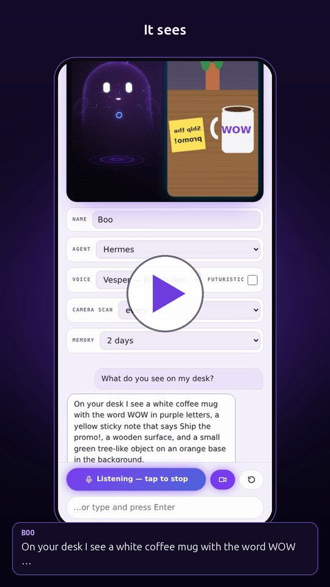
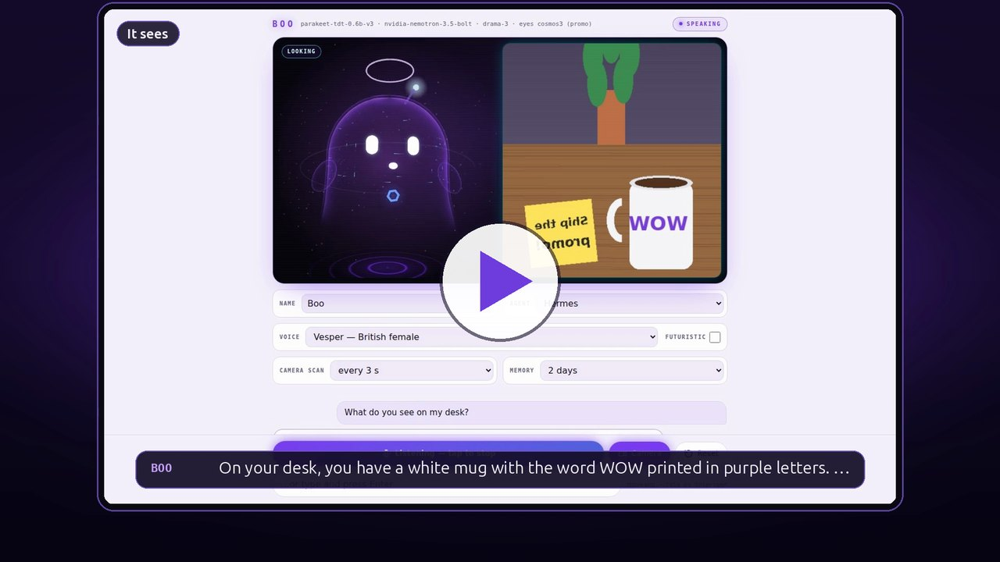
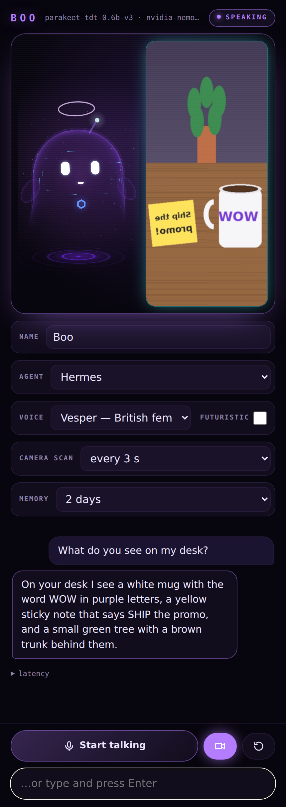
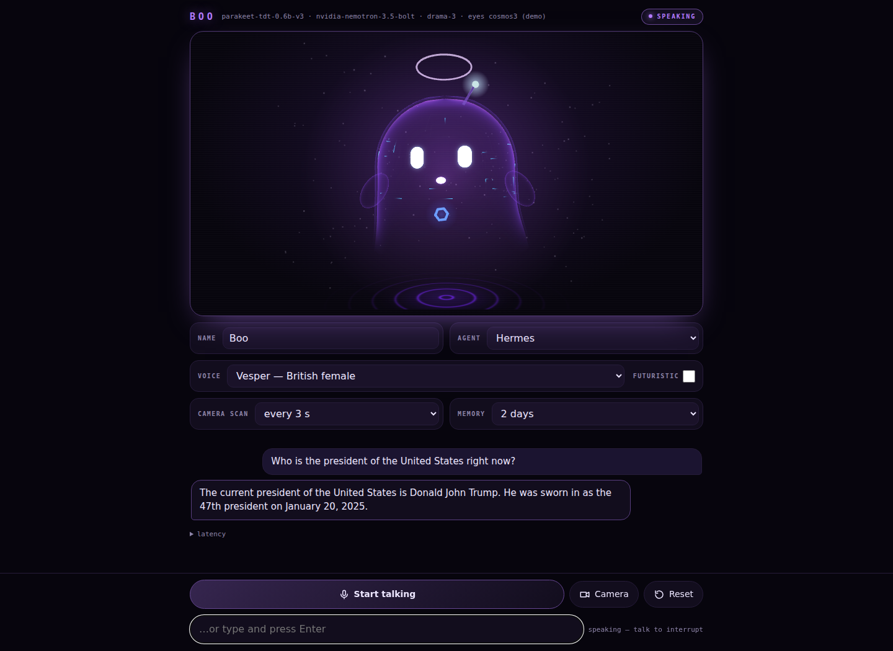
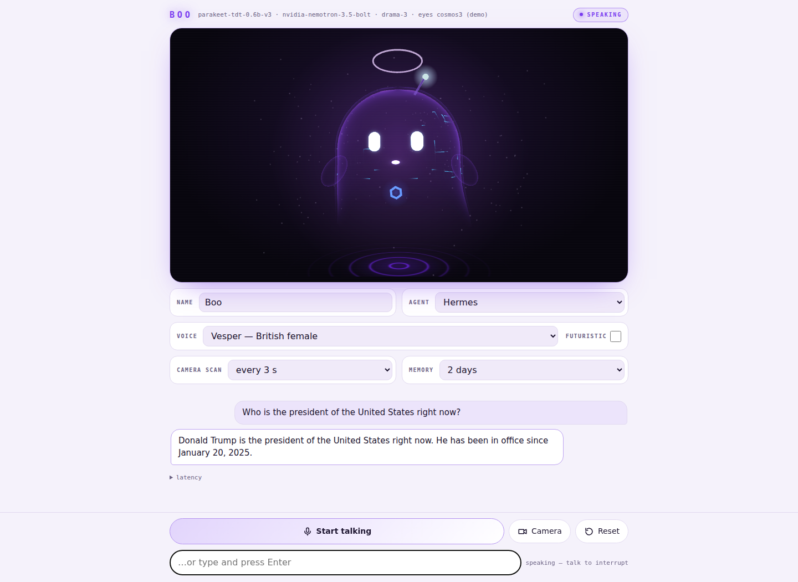
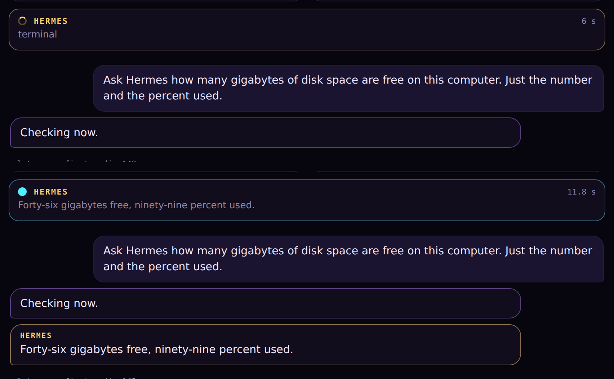
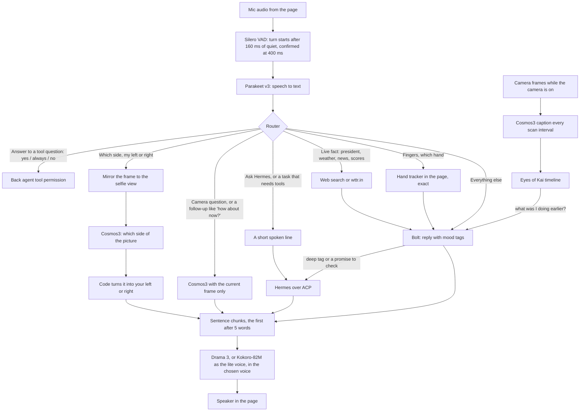

# Keys Ghost Machine — audio/visual agent, powered by [TensorFold](https://github.com/ashhart/TensorFold)

<a href="https://github.com/drowzeys/keys-ghost-machine-audio-visual-agent/blob/main/docs/media/promo-45s.mp4"></a>

▶ [Watch the 45-second demo](https://github.com/drowzeys/keys-ghost-machine-audio-visual-agent/blob/main/docs/media/promo-45s.mp4) (phone, 46 s, pauses trimmed)

**Boo** is a ghost-faced audio/visual agent you talk to in a browser. It hears you (Parakeet v3), answers out loud in
about half a second (Nemotron 3.5 Bolt and Fish Audio Drama 3), looks through your camera (Cosmos3-Edge), counts your
fingers exactly (MediaPipe hand tracking), remembers what it saw (Eyes of Kai), looks up live facts, and hands real
work to a back agent with tools (Hermes over ACP), asking out loud before anything that runs a command or writes. The
models run locally on TensorFold, on a Mac with Apple silicon or on an NVIDIA DGX Spark. A [lite voice](#lite-voice-kokoro-82m)
(Kokoro-82M) can stand in for Drama 3 where memory or disk is short.

Voices: [drowzeys/keys-ghost-machine-audio-visual-agent on Hugging Face](https://huggingface.co/drowzeys/keys-ghost-machine-audio-visual-agent)
(14 Drama 3 voices, Vesper is the default; the lite voice has Kokoro's stock voices, British bf_emma by default).

## Requirements

Two reference platforms, measured on the live stacks:

- **Linux on NVIDIA DGX Spark** (GB10, aarch64, CUDA 13, 128 GB unified memory).
- **macOS 26 on Apple silicon** (Metal).

| Component | Mac (memory) | DGX Spark (memory) | Disk |
|---|---|---|---|
| Nemotron 3.5 Bolt (TensorFold) | ≈ 45 GB | ≈ 31 GB | 24 GB |
| Drama 3 NVFP4 (TensorFold) | ≈ 28 GB wired (21 GB weights) | ≈ 21 GB | 21 GB |
| *or* Kokoro-82M, the [lite voice](#lite-voice-kokoro-82m) | ≈ 0.7 GB | ≈ 3.5 GB | ≈ 0.4 GB (+ its Python environment: ≈ 1 GB Mac, ≈ 5.5 GB Spark) |
| Cosmos3-Edge (TensorFold) | ≈ 2.8 GB | ≈ 3.5 GB | 2.4 GB converted (+7.2 GB original, needed only to convert) |
| Agent + Parakeet v3 | ≈ 3.1 GB (MLX) | ≈ 5.4 GB (NeMo) | ≈ 2.5 GB |
| Eyes of Kai | < 0.1 GB | < 0.1 GB | small |
| **Total** | **≈ 79 GB** | **≈ 61 GB** (+≈ 46 GB if weights are staged on /dev/shm for fast starts, optional) | **≈ 50 GB free** (≈ 57 GB while converting Cosmos) |
| **Total, lite voice** | **≈ 52 GB** | **≈ 44 GB** | **≈ 31 GB free** (Mac), **≈ 36 GB** (Spark) |

- **Mac minimum:** 96 GB unified memory (an M-series Max or Ultra); 128 GB or more recommended. Tested on an M5 Ultra
  with 256 GB. The lite voice does not lower this (Bolt sets the floor and a 64 GB Mac is too small either way), but it
  leaves about 9 GB more room.
- **DGX Spark minimum:** one DGX Spark (128 GB) with about 64 GB free, or **about 48 GB free with the lite voice**.
  Everything fits on one node; the reference setup splits it over two.
- **Software:** TensorFold 1.1.4 (release binaries for Bolt; the Drama 3 and Cosmos3 builds are described under
  Limitations), Python 3.11 or later, Node 22 or later for Eyes of Kai, and a browser with a microphone and camera.
  Safari on an iPhone works over HTTPS (for example through Tailscale Serve).
- **Optional:** the Hermes back agent and a deep model; any ACP agent or OpenAI-compatible model can take their place.

## One-shot install

One command on a DGX Spark or an Apple silicon Mac. It checks the machine against the requirements above, then installs
everything under `~/keys-ghost-machine`: the agent, the TensorFold 1.1.4 builds (checksums verified), a Python
environment, Eyes of Kai with its patch, the 14 voices and the models (Bolt, Drama 3 NVFP4, and Cosmos3-Edge converted
to TensorFold's 8-bit format), then starts Boo. No sudo. Run it again to resume or update; finished parts are skipped.

**DGX Spark** (Linux, GB10, CUDA 13):

```sh
curl -fsSL https://raw.githubusercontent.com/drowzeys/keys-ghost-machine-audio-visual-agent/main/install.sh | bash
```

**Mac** (Apple silicon, macOS 26+; install [Homebrew](https://brew.sh) first if you don't have Node 22):

```sh
curl -fsSL https://raw.githubusercontent.com/drowzeys/keys-ghost-machine-audio-visual-agent/main/install.sh | bash
```

The same script detects the platform. The first run downloads about 55 GB (Bolt 24 GB, Drama 3 22 GB, Cosmos3-Edge
7.2 GB to convert, then deleted) and takes a while; Parakeet v3 downloads itself the first time the agent starts.

**Lite voice** ([what it is](#lite-voice-kokoro-82m)): add `--voice lite` to skip Drama 3 (about 22 GB less to download)
and speak with Kokoro-82M, or `--voice both` to install both and get a Full/Lite switch in the page:

```sh
curl -fsSL https://raw.githubusercontent.com/drowzeys/keys-ghost-machine-audio-visual-agent/main/install.sh | bash -s -- --voice lite
```

| Setting | What it does | Default |
|---|---|---|
| `KGM_VOICE` | `full` (Drama 3), `lite` (Kokoro-82M) or `both`; same as `--voice`; a re-run keeps the last choice | `full` |
| `KGM_HOME` | Install folder | `~/keys-ghost-machine` |
| `KGM_MODELS` | Model folder | `$KGM_HOME/models` |
| `KGM_BOLT_DIR`, `KGM_DRAMA_DIR`, `KGM_COSMOS_DIR` | Use model folders you already have (Cosmos3: an already converted one) | in `KGM_MODELS` |
| `KGM_PORT_BASE` | Move all ports: base+1 Bolt, +8 (Mac) or +3 (Spark) Drama, +9 Cosmos3, +5 page, +70 Kai, +107 Kokoro | 8091, 8098/8093, 8099, 8095, 3870, 8197 |
| `KGM_START=0` | Install without starting | starts |
| `KGM_KEEP_SRC=1` | Keep the original Cosmos3-Edge download after converting | deleted |
| `KGM_FORCE=1` | Install even if the memory or disk check fails | refuses |
| `HF_TOKEN` | Hugging Face token, if you have one | not needed |

Settings go in front of `bash`, for example `curl -fsSL …/install.sh | KGM_HOME=/data/boo bash`.

**Run it** with `kgm` (linked into `~/.local/bin` when that folder exists, otherwise `~/keys-ghost-machine/bin/kgm`):

| Command | Does |
|---|---|
| `kgm start` | Starts Bolt, the voice (Drama 3 and/or Kokoro), Cosmos3-Edge, Eyes of Kai and the agent, waiting for each to answer |
| `kgm stop` | Stops them |
| `kgm restart [service]` | Restarts everything, or one of `bolt drama kokoro cosmos kai agent` |
| `kgm status` | Shows which parts are up, on which ports |
| `kgm logs [service]` | Follows a log (the agent's by default) |
| `kgm url` | Prints the page address and the Tailscale line for your phone |
| `kgm voice full\|lite\|both` | Switches the voice engine and restarts what changes (the engine must be installed: re-run the installer with `--voice`) |

Then open `http://127.0.0.1:8095/`. For your phone, put both on [Tailscale](https://tailscale.com) and run once
`tailscale serve --bg --https=8443 http://127.0.0.1:8095`; open `https://<this-machine>.<your-tailnet>.ts.net:8443`.
If `hermes` is on your PATH the installer wires it in as the back agent; otherwise `~/keys-ghost-machine/agents.example.json`
shows what to add to `~/keys-ghost-machine/profile.json`.

**Docker instead (DGX Spark):** after the installer has fetched the models (`KGM_START=0`), or with your own copies:

```sh
docker run --gpus all --rm -p 8095:8095 \
  -v ~/keys-ghost-machine/models/NVIDIA-Nemotron-3.5-Bolt-74B-A9B-24GB:/models/bolt \
  -v ~/keys-ghost-machine/models/drama-3-NVFP4-Pruned:/models/drama \
  -v ~/keys-ghost-machine/models/cosmos3-tf:/models/cosmos3 -e KAI=1 \
  ghcr.io/drowzeys/keys-ghost-machine-audio-visual-agent:0.1.0
```

`-e VOICE_ENGINE=lite` (no Drama mount needed) or `both` picks the voice in an image built from this commit
(see [docker/README.md](docker/README.md)); the published 0.1.0 image has the full voice only.

**Uninstall:** `kgm stop && rm -rf ~/keys-ghost-machine ~/.local/bin/kgm` (add `~/.cache/huggingface` if nothing else
uses its downloads).

## Lite voice (Kokoro-82M)

Drama 3 is the full voice: expressive, with the 14 custom voices, and the part of the stack that takes the most memory
after Bolt. The lite voice swaps it for [Kokoro-82M](https://huggingface.co/hexgrad/Kokoro-82M) (hexgrad, Apache-2.0),
an 82-million-parameter speech model, behind the same API (`voice_agent/kokoro_server.py`: MLX on the Mac through
mlx-audio, PyTorch CUDA on the DGX Spark). Everything else in Boo stays the same.

Measured on the live stacks with the same 16 questions and the same client:

| | DGX Spark, lite | DGX Spark, full | Mac, lite | Mac, full |
|---|---|---|---|---|
| Voice-to-voice, median | **0.33 s** | 0.55–0.77 s | 0.56–0.64 s | 0.47–0.60 s |
| Voice engine memory | **≈ 3.5 GB** | ≈ 42 GB | **≈ 0.7 GB** | ≈ 10 GB |
| Whole stack in use | **≈ 62 GB** | ≈ 101 GB | **≈ 55 GB** | ≈ 64 GB |
| Voice engine on disk | ≈ 0.4 GB | 21 GB | ≈ 0.4 GB | 21 GB |

These are memory in use while talking, read from the running stacks (the DGX Spark one with its weights staged in
memory); the [Requirements](#requirements) table counts what each part needs at load.

Kokoro is not autoregressive: a sentence's audio comes all at once, about 50–90 ms for a short first chunk on the
Spark's GPU, so it needs no keep-warm (profiles set `keep_warm: false` for it). Its leading ~250 ms of silence is cut.

**How to choose.** Take the full voice (Drama 3) when you have the memory: it sounds more alive, it has the 14 voices
made for Boo and it speaks more languages. Take the lite voice on a DGX Spark that shares its memory with other work,
when disk is short, or when you want the fastest replies on a Spark; take `both` to compare them in the page.

**What lite gives up:**

- The 14 custom Drama 3 voices and voice cloning; Kokoro has its own stock voices only.
- Drama 3's expressiveness, and the more expressive delivery still to come on it; Kokoro reads evenly.
- Languages: Boo's lite voice speaks English only (American and British voices). Kokoro itself also has Spanish,
  French, Italian, Portuguese, Hindi, Japanese and Mandarin voices, but no German; Drama 3 covers more, German included.

**Voices.** `bf_emma` (British female, warm and clear) is the default. Also offered: `bf_isabella`, `bf_alice`,
`bf_lily`, `bm_george`, `bm_fable`, `bm_lewis`, `bm_daniel` (British), `af_heart` (Kokoro's best-rated voice),
`af_bella`, `af_nicole`, `af_sarah`, `am_michael`, `am_fenrir`, `am_puck` (American). Previews of a few are in the
[Hugging Face repo](https://huggingface.co/drowzeys/keys-ghost-machine-audio-visual-agent/tree/main/previews/kokoro).

**Turning it on:** `install.sh --voice lite` (or `both`), `kgm voice lite` on an install that has it, `VOICE_ENGINE=lite`
for Docker, or by hand `./serve-kokoro.sh` then `./serve.sh profiles/mac.json lite` (see [Profiles](#profiles)).

## See it work

[](https://github.com/drowzeys/keys-ghost-machine-audio-visual-agent/blob/main/docs/media/promo-landscape.mp4)

Real recordings of the page, hands-free: [landscape, 1920×1080, 90 s](https://github.com/drowzeys/keys-ghost-machine-audio-visual-agent/blob/main/docs/media/promo-landscape.mp4) (above, the
[phone cut, 1080×1920, 46 s](https://github.com/drowzeys/keys-ghost-machine-audio-visual-agent/blob/main/docs/media/promo-45s.mp4)). The voices are synthetic Drama 3 voices and the desk is a
computer-made scene; no person appears.

## Screenshots

| Phone (camera on) | Desktop |
|---|---|
|  | <br><br> |

A task handed to Hermes: the card shows only the tool's name while it works, then the answer.



## What happens in a turn

Every spoken turn goes through one router. Quick paths answer in the same turn; only real tasks go to the back agent.



Rules that make it behave:

- **Camera answers are about the current frame only.** The camera model gets a short instruction and this question,
  with no conversation history and no older caption, so it cannot repeat an earlier answer. A short follow-up to a
  camera turn ("how about now?", "are you sure?", "look again") looks at the live frame again, carrying the original
  question.
- **The person in the picture is "you".** The camera model is told the picture shows the user, never itself.
- **Selfie left and right.** Cosmos3 was trained on first-person robot cameras: it knows which side of a picture a thing
  is on, but not your sides on a face-forward camera. So the agent mirrors the frame to your own view, asks only for
  the picture side, and says it as your side in code.
- **Fingers and hands come from the hand tracker**, never the camera model, which miscounts them.
- **The back agent gets only your words** (plus camera or hand facts when used), never the front brain's lines. A reply
  that only promises to check is sent back once to answer.
- **Back-agent tools need a spoken yes.** Read and search tools run freely; anything that runs a command, writes or
  sends asks first, out loud and on the page.
- **Mood tags** such as `[happy]` drive the ghost's face and are never spoken.

## Measured speed

Voice-to-voice is the end of your speech to the first sound of the reply, measured by a client streaming 16 recorded
questions in real time, three passes each, on TensorFold 1.1.4.

| Measure | Mac (M5 Ultra) | DGX Spark |
|---|---|---|
| Voice-to-voice, median | 0.47–0.60 s | 0.55–0.77 s |
| Speech recognition (Parakeet v3) | 72 ms | 86 ms |
| Nemotron 3.5 Bolt, first token | 60 ms | 59 ms |
| Drama 3 first audio, named voice (Vesper) | 122 ms | 121 ms |
| Cosmos3 camera answer, first token / full | 79 ms / 0.25 s | 103 ms / 0.33 s |
| Camera question, voice starts | 0.37–0.46 s | 0.60–0.73 s |
| Left / right question, voice starts | 0.26–0.31 s | 0.55–0.74 s |
| Live fact (search or weather), voice starts | 1.3–3.8 s | ≈ 2.6 s |
| Back-agent task with tools | 30–50 s | 30–50 s |

On TensorFold 1.1.3 the DGX Spark measured 0.92–0.95 s voice-to-voice, with Drama 3 first audio in Vesper at 415 ms
and Bolt's first token at 95 ms.

**What TensorFold 1.1.4 brought:** Drama 3 prompt rows in chunks on CUDA (`TF_DRAMA_PREFILL_ROWS`), idle unload
(`--idle-unload`), a `/health` that turns 503 on a dead CUDA context, and attested voice catalogs upstream.
**What is still ours** (in the [prebuilt builds](#prebuilt-builds)): Bolt on Metal, NVFP4 pruned Drama 3 experts, the
voice-prefix cache, and the Cosmos3-Edge ports for Metal and CUDA. The DGX Spark's Drama 3 still runs on
plotarmordev's NVFP4 fork, because stock 1.1.4 refuses the pruned checkpoint.

**Fast short replies no longer deafen a session.** A quick reply such as "I'm on it." could finish before the
person's silence was confirmed; letting it out then marked Boo as still speaking after the reply had ended, and the
session stopped listening. Boo now clears that state when the reply is already done (found with the lite voice, whose
short replies finish fastest; since the fix every turn was heard: 64 of 64 in testing, 20 of 20 in an install test).

**Long lines that go quiet.** Drama 3 sometimes speaks the first sentence of a long line and then only silence or a
flat hum near −36 dBFS until the frame cap, on about 1 in 5 paragraph-length inputs, and the same input every time
(the seed comes from the prompt; [ashhart/TensorFold#1275](https://github.com/ashhart/TensorFold/issues/1275)). It is
the model's sampling, not a TensorFold bug, and 1.1.3 does the same. On the Mac, `kgm` starts Drama 3 with 1.1.4's
silence guard: `--silence-floor-dbfs=-30 --silence-seconds=4 --silence-mid-s=2 --silence-mid-min-voiced-s=1
--silence-redraws=3 --silence-redraw-budget-s=90` (whole replies are redrawn; good takes stay byte-identical). The
guard never redraws a stream, and the DGX Spark's NVFP4 engine has no guard yet, so Boo also checks each streamed
take itself: after 3 s under −30 dBFS it drops the quiet tail and asks for the text after the last sentence spoken
(a new text draws a new seed). On 12 paragraphs the stalled one came back whole in one extra request, and the other
11 were byte-identical with the check on.

## Settings in the page

- **Name**: what the assistant is called (Boo by default); it answers to it, and the header follows.
- **Agent**: the back agent (Hermes over ACP, or a direct OpenAI-compatible model).
- **Voice engine** (only when both are running, `--voice both`): Full (Drama 3) or Lite (Kokoro-82M), per
  conversation; each remembers its own voice on the device.
- **Voice**: any voice the voice engine offers (Drama 3's loaded voices, or Kokoro's), with its description;
  **Futuristic** adds a light chorus, a short airy echo and a treble lift in the browser (no server cost).
- **Camera scan**: how often the camera is captioned into memory while the camera is on: every 1, 2, 3 (default), 5,
  10 or 30 seconds, or every 1, 5 or 15 minutes.
- **Memory**: how long captions are kept: 1, 2 (default), 3 or 5 days, or 1 week.

## Prebuilt builds

The [v0.1.0 release](https://github.com/drowzeys/keys-ghost-machine-audio-visual-agent/releases/tag/v0.1.0) has
unofficial community builds of TensorFold 1.1.4 with everything Boo needs that upstream does not ship yet:

- `keys-boo-tensorfold-1.1.4-macos-arm64.tar.gz`: one `tensorfold-native` for Apple silicon that serves Nemotron 3.5
  Bolt (with `libbolt.dylib`), Drama 3 NVFP4 with named voices and the voice-prefix cache, and Cosmos3-Edge on Metal.
- `keys-boo-tensorfold-1.1.4-linux-aarch64.tar.gz`: for a DGX Spark, `tensorfold-cosmos3` (Cosmos3-Edge on CUDA) and
  `tensorfold-drama3-nvfp4` (Drama 3 NVFP4 with the voice-prefix cache). Bolt uses the stock
  [TensorFold 1.1.4](https://github.com/ashhart/TensorFold/releases/tag/v1.1.4) release.

Each archive has its own README with run commands, a change list, the licences and `SHA256SUMS`. The source is
[drowzeys/TensorFold](https://github.com/drowzeys/TensorFold), branches `bolt-metal-114`, `drama3-metal-voices-114`,
`cosmos3-metal-114`, `cosmos3-cuda-114` and `drama3-cuda-voices`.

**Docker (DGX Spark):** the whole Spark stack in one image, without model weights
(about 25 GB, built on NVIDIA's PyTorch container):

```sh
docker pull ghcr.io/drowzeys/keys-ghost-machine-audio-visual-agent:0.1.0
docker run --gpus all --rm -p 8095:8095 \
  -v ~/models/bolt:/models/bolt -v ~/models/drama:/models/drama -v ~/models/cosmos3:/models/cosmos3 \
  -v ~/models/hf-cache:/models/hf-cache -e KAI=1 \
  ghcr.io/drowzeys/keys-ghost-machine-audio-visual-agent:0.1.0
```

Mounts and settings are in [docker/README.md](docker/README.md).

## Manual setup

What the one-shot installer does, by hand:

1. **Engines (TensorFold).** Serve, each on its own port:
   - Nemotron 3.5 Bolt with the TensorFold 1.1.4 release (`tensorfold serve … --no-thinking --context 32768`), on
     `:8091`.
   - Drama 3 NVFP4 with named voices: `--voices ~/voices/<mac|spark> --default-voice vesper` (voices from the Hugging
     Face repo), on `:8098` (Mac) or `:8093` (Spark). On a build with 1.1.4's silence guard add
     `--silence-floor-dbfs=-30 --silence-seconds=4 --silence-mid-s=2 --silence-mid-min-voiced-s=1 --silence-redraws=3
     --silence-redraw-budget-s=90` (see [Measured speed](#measured-speed)).
   - Cosmos3-Edge with `--vision` and `--keep-warm 0`, on `:8099`.
   - Or, for the lite voice instead of (or beside) Drama 3: Kokoro-82M in its own environment, on `:8197`:
     ```sh
     python3 -m venv kokoro-venv
     kokoro-venv/bin/pip install -r requirements-kokoro-mac.txt   # Spark: install CUDA 13 PyTorch first, then requirements-kokoro-spark.txt
     ./serve-kokoro.sh                                            # KOKORO_VOICE=af_heart picks another default
     ```
2. **Eyes of Kai.** Clone [tonyd2wild/eyes-of-kai](https://github.com/tonyd2wild/eyes-of-kai), apply
   `patches/eyes-of-kai-retention.patch` (`git apply`), set `PORT=3870` and `BIND_HOST=127.0.0.1` in its `.env`, and
   start it with Node 22 (`node src/server.js`).
3. **The agent.**
   ```sh
   python3 -m venv venv
   venv/bin/pip install -r requirements-mac.txt      # or requirements-spark.txt on a DGX Spark
   cp profiles/mac.example.json profiles/mac.json   # edit ports, voices folder and back agents
   ./serve.sh profiles/mac.json                     # add "lite" or "both" for the lite voice
   ```
   Open `http://127.0.0.1:8095/`. For a phone, serve it over HTTPS (browsers only give the microphone and camera to
   secure pages), for example with `tailscale serve --https=8443 http://127.0.0.1:8095`.
4. **Back agent (optional).** The example profile starts `hermes acp` locally. To use one on another machine, set its
   `command` to `["ssh", "-T", "user@host", "hermes", "acp"]`. The `deep` agent is any OpenAI-compatible endpoint.

`python -m voice_agent.bench ws://127.0.0.1:8095/ws a.wav b.wav …` measures voice-to-voice from spoken questions as
16 kHz mono WAV files (any voice engine's sample rate; `--agent NAME` hands deep requests to another back agent, for
example a tool-free one, while measuring). No recordings ship with the repository; make test questions with a synthetic Drama 3 voice, for
example:

```sh
curl -s http://127.0.0.1:8098/v1/audio/speech -H 'Content-Type: application/json' \
  -d '{"model": "drama-3", "voice": "oliver", "input": "What is the weather like today?", "response_format": "wav"}' -o q.wav
ffmpeg -y -i q.wav -ac 1 -ar 16000 a.wav
```

## Profiles

A profile names each engine and the turn timing:

- `asr`: `parakeet-mlx` (Mac) or `nemo` (Spark) with the model id.
- `brain`: the front model's URL, model name, system prompt and sampling.
- `voice`: the Drama 3 URL, default voice, voices folder (for previews and descriptions) and `first_words` (the first
  spoken chunk is cut after this many words). `keep_warm: false` stops the warm-up requests (for an engine that starts
  at once).
- `voice_engine`: `full` (default), `lite` or `both`; `--voice` on the command line or `VOICE_ENGINE` overrides it.
  `voice_lite` changes the lite voice's settings (default: Kokoro-82M at `http://127.0.0.1:8197/v1`, voice `bf_emma`,
  no keep-warm).
- `turn`: VAD timing (`eager_silence_ms` starts work early, `end_silence_ms` confirms the end of a turn).
- `eyes`: the camera model; `memory`: Eyes of Kai's URL, the captioner and `interval_s`.
- `agents` and `agent`: the back agents and the default one.

## Limitations

- **Cosmos3-Edge on TensorFold** needs the Cosmos3 ports (a new Metal model family and its CUDA counterpart), which are
  not in TensorFold's upstream releases yet; use the [prebuilt builds](#prebuilt-builds). Without them, point `eyes`
  and `memory.captioner` at any OpenAI-compatible vision model that accepts PNG images.
- **Drama 3 on the Mac** in the measured setup uses Metal changes offered upstream in
  [plotarmordev/TensorFold #1](https://github.com/plotarmordev/TensorFold/pull/1) (prompt rows) and
  [#2](https://github.com/plotarmordev/TensorFold/pull/2) (NVFP4 pruned experts), plus a voice prefix cache. The
  **DGX Spark** runs Drama 3 with [plotarmordev's TensorFold fork](https://github.com/plotarmordev/TensorFold) plus
  the same voice-prefix cache; stock TensorFold 1.1.4 does not load the NVFP4 pruned checkpoint yet.
- Free-form camera descriptions ("describe what you see") can still name a side wrongly; questions about a side go
  through the reliable path above.
- Live facts come from web search snippets, which can be out of date; ask the back agent for anything that needs
  digging.
- Fish Audio's licence applies to Drama 3 speech: hosted services that generate speech for third parties need a
  separate licence from Fish Audio. Kokoro-82M is Apache-2.0.
- The lite voice is English only in Boo, has no mood in its delivery, and cannot clone or use the Drama 3 voices.

## Questions and issues

Please use [GitHub Issues](https://github.com/drowzeys/keys-ghost-machine-audio-visual-agent/issues).

## Licence

The code is MIT (LICENSE). Everything below keeps its own licence.

## Credits

| Component | What it does in Boo | Author / org | Licence | Link |
|---|---|---|---|---|
| Nemotron 3.5 Bolt | The front brain: answers most turns, with mood tags for the face | NVIDIA | NVIDIA Open Model License | [Hugging Face](https://huggingface.co/nvidia/NVIDIA-Nemotron-3.5-Bolt-74B-A9B-24GB) |
| Cosmos3-Edge | Camera questions and memory captions (its reasoner tower) | NVIDIA | OpenMDW 1.1 | [Hugging Face](https://huggingface.co/nvidia/Cosmos3-Edge) |
| Parakeet TDT 0.6B v3 | Speech to text | NVIDIA | CC-BY-4.0 | [Hugging Face](https://huggingface.co/nvidia/parakeet-tdt-0.6b-v3) |
| parakeet-mlx | Runs Parakeet on the Mac | senstella | Apache-2.0 | [GitHub](https://github.com/senstella/parakeet-mlx) |
| NeMo | Runs Parakeet on the DGX Spark | NVIDIA | Apache-2.0 | [GitHub](https://github.com/NVIDIA/NeMo) |
| Drama 3 | The voice (speech synthesis); the 14 named voices are takes of its built-in voice | Fish Audio | Fish Audio Community License | [Hugging Face](https://huggingface.co/fishaudio/drama-3) |
| drama-3-NVFP4-Pruned, NVFP4 CUDA fork and named voices | The 4-bit pruned Drama 3 checkpoint, the DGX Spark's Drama engine and `--voices` | plotarmordev | Fish Audio Community License (weights) · Apache-2.0 (engine) | [checkpoint](https://huggingface.co/plotarmordev/drama-3-NVFP4-Pruned) · [fork](https://github.com/plotarmordev/TensorFold) |
| TensorFold | The engine for Bolt, Drama 3 and Cosmos3-Edge, on Metal and CUDA | Ash Hart | Apache-2.0 | [GitHub](https://github.com/ashhart/TensorFold) |
| Kokoro-82M | The lite voice (optional, instead of Drama 3) | hexgrad | Apache-2.0 | [Hugging Face](https://huggingface.co/hexgrad/Kokoro-82M) |
| kokoro | Runs Kokoro-82M on PyTorch (DGX Spark) | hexgrad | Apache-2.0 | [GitHub](https://github.com/hexgrad/kokoro) |
| mlx-audio | Runs Kokoro-82M on MLX (Mac); weights from `mlx-community/Kokoro-82M-bf16` | Prince Canuma (Blaizzy) | MIT | [GitHub](https://github.com/Blaizzy/mlx-audio) |
| misaki | Kokoro's text-to-phoneme step (G2P) | hexgrad | Apache-2.0 | [GitHub](https://github.com/hexgrad/misaki) |
| spaCy and en_core_web_sm | English tokenising and tagging inside misaki | Explosion | MIT | [GitHub](https://github.com/explosion/spaCy) |
| espeak-ng (through phonemizer-fork and espeakng-loader) | misaki's fallback pronunciation for words its dictionary lacks | espeak-ng contributors | GPL-3.0 | [GitHub](https://github.com/espeak-ng/espeak-ng) |
| StyleTTS 2 | The architecture Kokoro-82M is built on (with an iSTFTNet decoder) | Yinghao Aaron Li et al. | MIT | [GitHub](https://github.com/yl4579/StyleTTS2) |
| Eyes of Kai | The continuity log: timestamped captions so Boo can answer about the past | tonyd2wild | MIT | [GitHub](https://github.com/tonyd2wild/eyes-of-kai) |
| Hermes Agent | The back agent with tools and skills, over ACP | Nous Research | see repository | [GitHub](https://github.com/NousResearch/hermes-agent) |
| qwen-audio-agent | Design inspiration: the frontstage/backstage split (a fast voice in front, a tool-using agent behind that reports back); no code from it is used | Qwen Audio team | Apache-2.0 | [GitHub](https://github.com/QwenAudio/qwen-audio-agent) |
| RED-SNOW 5.3 Flash | The back agent's model in the reference setup (a GLM-5.3-Flash build); any OpenAI-compatible model works | RED-SNOW | see model card | — |
| Silero VAD v5 | Hears when someone is speaking (`silero_vad.onnx` ships here) | Silero | MIT | [GitHub](https://github.com/snakers4/silero-vad) |
| MediaPipe Face Detector and Hand Landmarker | Gaze tracking, exact finger counts and which hand, in the page | Google | Apache-2.0 | [GitHub](https://github.com/google-ai-edge/mediapipe) |
| Three.js | Boo, the 3D ghost | three.js authors (mrdoob) | MIT | [GitHub](https://github.com/mrdoob/three.js) |
| ddgs | Web search for quick live facts | deedy5 | MIT | [GitHub](https://github.com/deedy5/ddgs) |
| wttr.in | Weather for quick live facts (data from WorldWeatherOnline) | Igor Chubin | Apache-2.0 | [GitHub](https://github.com/chubin/wttr.in) |
| NVIDIA PyTorch container | The Docker image's base (`nvcr.io/nvidia/pytorch:26.07-py3`) | NVIDIA | NVIDIA Deep Learning Container License | [NGC](https://catalog.ngc.nvidia.com/orgs/nvidia/containers/pytorch) |
| Qwen3.5-0.8B (earlier versions) | The first memory captioner | Qwen team, Alibaba Cloud | Apache-2.0 | [Hugging Face](https://huggingface.co/Qwen) |
| AEON-7 Nemotron 3 Nano Omni build (earlier versions) | The first camera model, from NVIDIA's Nemotron 3 Nano Omni | AEON-7 | NVIDIA Open Model License | [Hugging Face](https://huggingface.co/AEON-7) |

Full details: [CREDITS.md](CREDITS.md)
