# Ghost Multiverse Studio

**Ghost Machine + AutoPilot on a headless Imagination Studio.** One DGX Spark hears you, answers out loud, and makes
pictures, clips and whole short films from what you say. This branch (`ghost-studio`) adds four modes to
[Ghost Machine](#keys-ghost-machine--audiovisual-agent-powered-by-tensorfold)'s voice agent, Boo. The tabs for them are
in the top right corner of every page.

| Mode | Page | What it is for |
|---|---|---|
| Ghost Agent | `/classic` | Talk to Boo and the back agent. The camera, Boo, and a status column: what the agent is doing, and the local models with a load and unload button each. |
| Multiverse Timeline | `/invisible` | The Ghost watches a timeline of everything the studios on the machine make; ask it to find anything. |
| Multiverse Generator | `/` | Walk a film as a tree of choices: every scene offers ways on, and any branch can be filmed. |
| Live Action | `/live-action` | Rehearse a scene with its cast, call "action" and "cut", and the take is filmed and played back. |

No model weights are in this repository or in its image. Read [Licences and where it may be used](#licences-and-where-it-may-be-used)
before you run it: the clip model is MiniMax H3, whose licence excludes several territories.

## Live Action

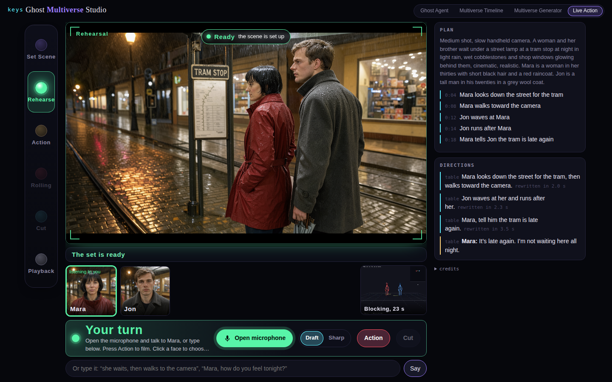

A light down the left edge says where the scene is, and each lamp is a button that goes there.

1. **Set Scene.** Describe the shot in a sentence or a whole story. Name the cast on lines of their own
   (`Mara: a woman in her thirties, short black hair, a red raincoat`), or let the assistant read them out of the
   story. The monitor says **Wait** while the reference shot, a close-up of each character and the blocking preview
   are made (about two minutes), then **Ready**.
2. **Rehearse.** Open the microphone and talk to the cast; each answers in its own voice from its close-up. Say what
   happens ("she walks to the camera", "they fight, then fire at each other") and it becomes a timed beat in the plan.
3. **Action.** The plan plays in real time as stick figures on a floor plan, with the lines spoken at their seconds.
   The figures walk, run, turn, fight, jump, crouch, dance and sit, and punch, kick, wave, fly and fire a blast.
   Talk to a character during the run-through and the answer stays in the plan.
4. **Cut.** The run-through stops, and what was played is filmed at once behind the rehearsal (**Rolling**), in
   five-second parts. You can go on rehearsing while it films.
5. **Playback.** The take plays on the monitor when it is made, and stays under Takes.

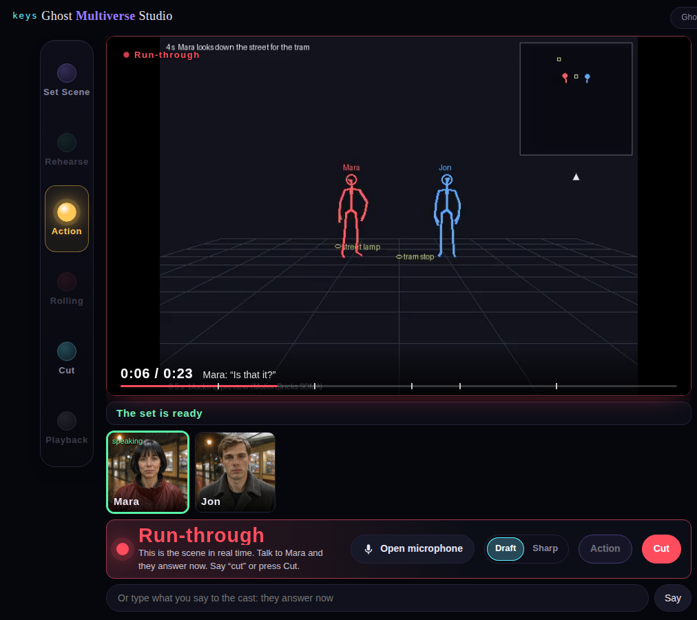

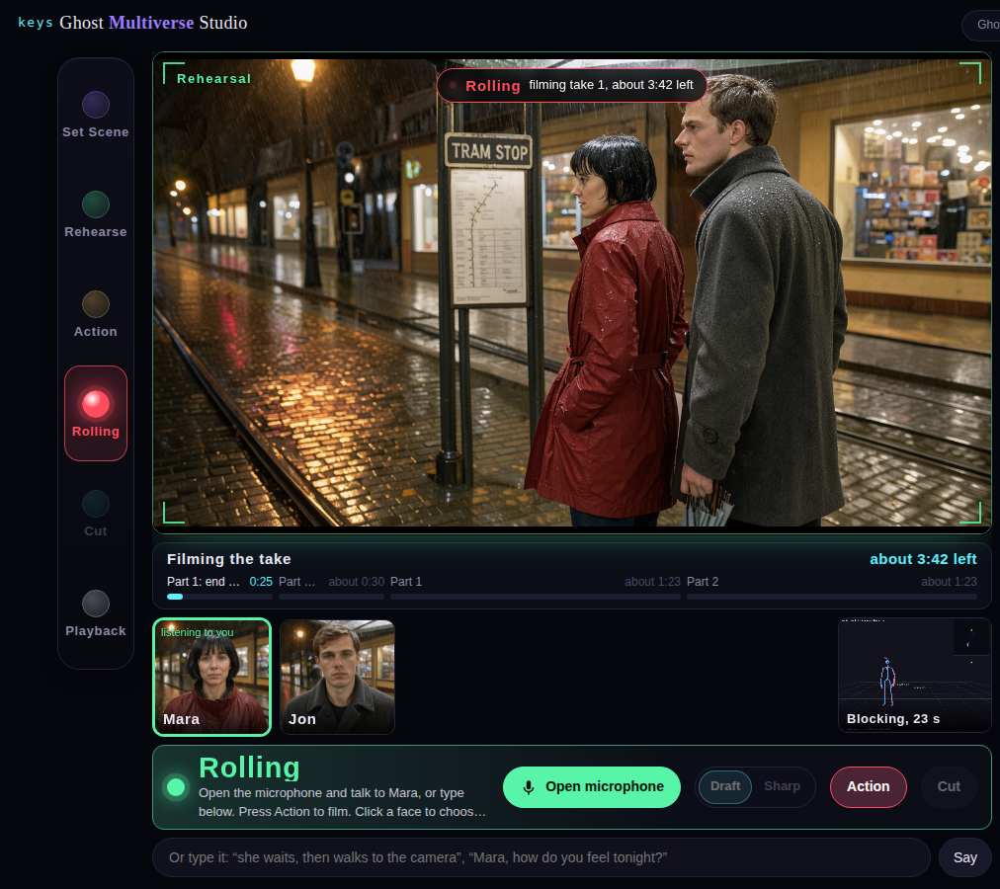

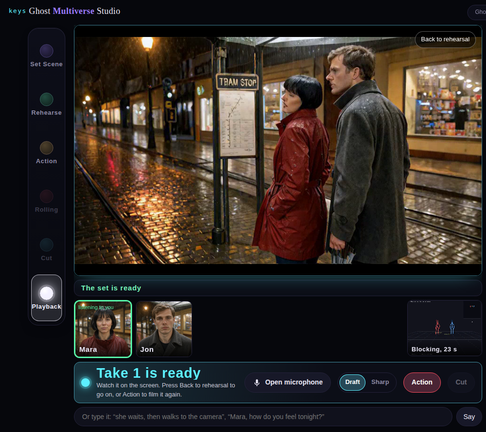

Measured on one DGX Spark (2026-11-20, Draft quality, 864x480): "action" to the run-through playing, about 1 s; a
character's answer during the run-through, 0.65 s; a 5 s take, 3.5 minutes from the cut to playback. Sharp quality
(1376x768) takes about four minutes for each five seconds and holds the stage while it films.

## Ghost Agent

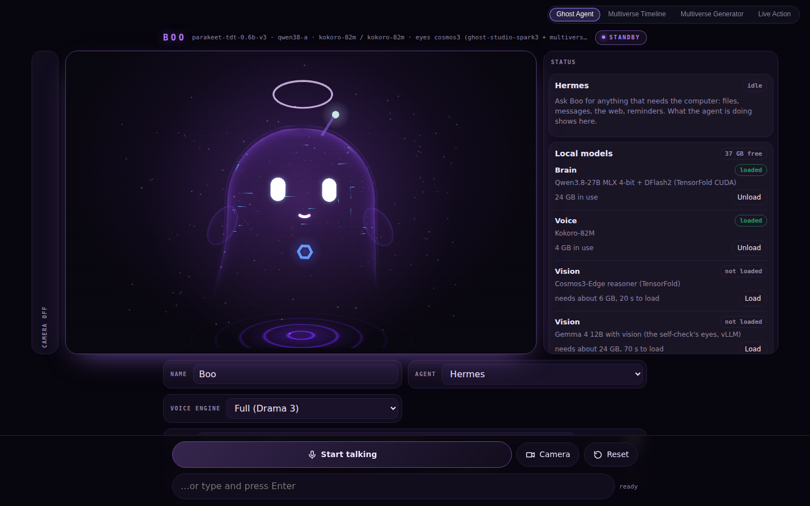

The page for talking: no video panel. Ask for anything that needs the computer and Boo hands it to the back agent
(Hermes over ACP in the example profile), whose steps show in the status column. Questions about what the camera
sees go to the vision model. Each local model shows whether it is loaded and how much memory it holds.

## Updates

**2026-11-20**

- Live Action is new: the reference shot, the cast's close-ups, the blocking preview, the run-through, the take.
- A scene written as a story, with nobody named on a line of their own, is read into a cast, an opening picture and
  timed beats.
- The cast can be talked to during the run-through.
- A cut films the take by itself, behind the rehearsal (`live.auto_take`), and the page plays it when it is made.
- The status light, and the Wait / Ready / Rolling sign on the monitor.
- The blocking preview's figures act: MotionBricks' sample motions for a fight stance, a jump, a crouch, a dance and
  sitting; punches, kicks, blasts, waves and flights drawn over them.
- Ghost Agent: the video panel is gone; the back agent's status and the local models are in its place.
- The mode tabs are renamed, Ghost Agent comes first, and they sit in the top right corner on every page.
- Fixed: a browser that will not start the run-through's film by itself (Safari) left the figures standing; the
  picture is now moved to the clock by hand.
- Fixed: a camera question got no answer when the vision model was started without `--vision`.

Earlier work on this branch (the FP4 clip worker, AutoPilot's self-check, the memory guard, the headless Studio, the
Multiverse tree and timeline) is in the [build notes](docs/ghost-studio-notes.md).

## Recipe

Ghost Studio has been built and run on **one** DGX Spark (GB10, 128 GB, CUDA 13), by hand. There is no one-shot
installer for this branch yet: the steps below are what that machine has, in order. Ghost Machine's own one-shot
installer, [further down](#one-shot-install), installs Boo alone.

1. **This branch.**
   ```sh
   git clone -b ghost-studio https://github.com/drowzeys/keys-ghost-machine-audio-visual-agent ~/ghost-studio/repo
   cd ~/ghost-studio/repo && python3 -m venv ~/ghost-studio/venv
   ~/ghost-studio/venv/bin/pip install -r requirements-spark.txt    # after a CUDA 13 build of PyTorch for aarch64
   ```
2. **The engines the profile names.** A brain, a voice and (for camera questions) a vision model, each any
   OpenAI-compatible server. The example profile uses TensorFold builds of Qwen3.8-27B and Cosmos3-Edge (served with
   `--vision`), Kokoro-82M (`serve-kokoro.sh`) and Parakeet v3 for hearing.
3. **Imagination Studio**, installed with its own installer and left unmodified. Ghost Studio starts it headless and
   asks it for every keyframe and for a film's sound ([build notes](docs/ghost-studio-notes.md#the-headless-studio)).
4. **The clip worker**: a Python environment with FastVideo and the FastH3 V2 NVFP4 weights, which you download
   yourself under their licence ([build notes](docs/ghost-studio-notes.md#the-fp4-clip-worker) has the commands).
5. **For Live Action's blocking preview**: a checkout of [NVlabs/motionbricks](https://github.com/NVlabs/motionbricks)
   with its ONNX model and sample motions (`git lfs pull`), and ONNX Runtime, NumPy and Pillow installed beside it
   with `pip --target`. It runs on the CPU in a container with no network. Optional: MuseTalk 1.5 for the close-ups'
   lips.
6. **The profile.** Copy `profiles/spark.example.json`, point its paths at what you installed, and keep the `live`,
   `multiverse` and `watch` sections for the modes you want.
7. **Start it.**
   ```sh
   ~/ghost-studio/venv/bin/python -m voice_agent.server --profile ~/ghost-studio/profile.json --port 8196
   ```
   Then open `http://localhost:8196/`. The microphone and the camera need `localhost` or https.

### The image

`ghcr.io/drowzeys/keys-ghost-machine-audio-visual-agent:ghost-studio` holds this branch's app and its Python
dependencies for a DGX Spark (linux/arm64): the four pages, the voice loop, AutoPilot, the Multiverse and the Live
Action stage's own code. It holds no weights and no engines. Give it a profile whose engines are servers that already
run (`"mode": "adopt"`, or plain URLs); see [docker/README.md](docker/README.md#ghost-studio).

## Licences and where it may be used

Ghost Machine's own code is MIT (see [LICENSE](LICENSE)); the code kept from Imagination Studio and AutoPilot is
Apache-2.0 (see [LICENSES](LICENSES)). What they drive is not all so:

- **MiniMax H3** (every clip and take; FastH3 on FastVideo) is under the MiniMax H3 Community License, which **excludes
  the USA, the EU, the UK and South Korea** without MiniMax's authorization. Check that licence for where you are
  before you download the weights or make a clip. Nothing of H3 is shipped here.
- **Drama 3** is under the Fish Audio Community License; hosted commercial use needs a licence from Fish Audio.
- **MotionBricks**' sample motions are under the NVIDIA Sample Data Evaluation License (for evaluating and testing
  NVIDIA technologies); its code is Apache-2.0 and its weights are under the NVIDIA Open Model License.
- Everything else, with its licence and what it is used for, is in [CREDITS.md](CREDITS.md) and in the credits at the
  foot of each page.

---

# Keys Ghost Machine — audio/visual agent, powered by [TensorFold](https://github.com/ashhart/TensorFold)

## What's new in v0.3.0

**TensorFold 1.1.5.** Bolt on a DGX Spark runs on the stock TensorFold 1.1.5 release, and the keys builds move to 1.1.5:
Bolt and Cosmos3-Edge on the Mac (one `tensorfold-native` with `libbolt.dylib`) and Cosmos3-Edge on CUDA. To update,
run the install command again, then `kgm restart`; in Docker,
`docker pull ghcr.io/drowzeys/keys-ghost-machine-audio-visual-agent:0.3.0`.

- **Same answers, same speed.** On an M5 Ultra, against the 1.1.4 builds with the same flags: Bolt's greedy replies
  are identical (7 of 7; first token 77–81 ms and about 96 tokens a second on both), and Cosmos3-Edge answers the
  camera test pictures identically (7 of 7, first token 78 ms on both). On a DGX Spark Cosmos3-Edge's first token is
  101–103 ms on both.
- **The Mac's Drama 3 stays on the 1.1.4-keys.1 engine**, shipped in the Mac archive as `bin/tensorfold-drama`.
  TensorFold 1.1.5 reads the NVFP4 pruned checkpoint on Metal and reuses a voice's reference prefill upstream, but on
  an M5 Ultra its first audio in a named voice was 107–343 ms against a steady 67–79 ms for the keys engine (1.1.5
  keeps one voice prefix per stream and restores whole prompt rounds only), so Boo keeps the faster engine. The DGX
  Spark's Drama 3 is unchanged as well: plotarmordev's NVFP4 fork with the voice-prefix cache and the silence guard.
- **The v0.2.2 fixes stay:** no Drama 3 keep-warm line on the DGX Spark, and cuBLASLt 13.1 for the TensorFold engines
  in the Docker image.

### v0.2.2

**Full voice on a DGX Spark answers about twice as fast: 0.47–0.55 s voice to voice instead of 1.0–1.1 s** (Docker
image, 7 synthetic questions, two passes, with 0.5 s and 8 s between turns). To update, run the install command again,
then `kgm restart`; in Docker, `docker pull ghcr.io/drowzeys/keys-ghost-machine-audio-visual-agent:0.2.2`.

- **The Spark no longer keeps Drama 3 warm with a throwaway "Mm."** while you speak. Its CUDA Drama 3 runs one
  synthesis at a time, so when you stopped, the reply's first sentence waited (503, retried) until that line ended,
  and the extra speech slowed speech recognition and Bolt too. On CUDA Drama 3 starts fast from idle anyway (~115 ms
  first audio). The DGX Spark profile now sets `"keep_warm": false` on the voice; Bolt is still kept warm, and the Mac
  is unchanged. This applies to native installs as well as Docker.
- **Docker: Drama 3 speaks on its fast kernel again.** The image's CUDA libraries (cuBLASLt 13.6) made the Spark Drama
  3 build switch its one-row tower kernel off; the TensorFold engines in the image now get the cuBLASLt 13.1 they are
  qualified with (PyTorch keeps the image's own).

The engine archives are unchanged from v0.2.0 (same files, same SHA-256), re-attached to the v0.2.2 release.

### v0.2.1

A fix release for v0.2.0 (superseded by v0.2.2).

- **Fresh DGX Spark installs: the page could not connect** after Parakeet warmed up. NeMo's CUDA-graph decoder wrote a
  NUL into Python's shared `b" "` object (an empty NVRTC log read into `b" " * 1`), which broke uvicorn's status lines
  and websockets' parser and left damaged `.pyc` files. Boo now gives NVRTC its own buffer (the Docker
  image was not affected).
- **"(Boo says)" at the start of a reply:** after a switch of voice engine (Full/Lite) or voice, the sample line "Hi,
  this is how I sound now." went into the conversation as "(Boo says) Hi, this is how I sound now.", and Bolt could
  copy the label, or the whole line, into its next replies. The sample line is no longer kept in the conversation,
  Boo's own short lines ("Okay, going ahead.") are kept without a label, and a reply that still starts with a stage
  direction such as "(Boo says)" loses it before it is spoken or stored.
- **Docs:** the Mac's Drama 3 first audio in [Measured speed](#measured-speed) is ~60 ms on TensorFold 1.1.4 (it said
  122 ms, the figure after the engine has sat idle), matching the table below.

### New in v0.2.0: Kokoro Lite, a second voice for smaller machines

[Kokoro-82M](https://huggingface.co/hexgrad/Kokoro-82M)
(hexgrad, Apache-2.0) can now speak for Boo instead of Drama 3, or beside it with a switch in the page. It is for
memory-constrained hardware: a DGX Spark that shares its memory with other work, or a Mac at the low end of the
[requirements](#requirements). Everything else (Bolt, Cosmos3-Edge, Parakeet, Eyes of Kai, Hermes) stays the same.

- **Install Lite, DGX Spark** (about 48 GB free memory):
  `curl -fsSL https://raw.githubusercontent.com/drowzeys/keys-ghost-machine-audio-visual-agent/main/install.sh | bash -s -- --voice lite`
- **Install Lite, Mac** (Apple silicon, macOS 26+; 96 GB comfortable, 64 GB tight): the same command,
  `curl -fsSL https://raw.githubusercontent.com/drowzeys/keys-ghost-machine-audio-visual-agent/main/install.sh | bash -s -- --voice lite`
- **Docker, Lite** (DGX Spark, no Drama 3 mount needed):
  ```sh
  docker run --gpus all --rm -p 8095:8095 -e VOICE_ENGINE=lite -e KAI=1 \
    -v ~/keys-ghost-machine/models/NVIDIA-Nemotron-3.5-Bolt-74B-A9B-24GB:/models/bolt \
    -v ~/keys-ghost-machine/models/cosmos3-tf:/models/cosmos3 -v ~/models/hf-cache:/models/hf-cache \
    ghcr.io/drowzeys/keys-ghost-machine-audio-visual-agent:0.3.0
  ```
- **Both, with a Full/Lite toggle:** install with `--voice both` (or `-e VOICE_ENGINE=both` in Docker, with the
  Drama 3 mount) and the page shows a **Full / Lite** switch per conversation; the voice list follows the engine.
  On an existing install, `kgm voice full|lite|both` switches. Pick a Kokoro voice in the page's Voice list
  (`bf_emma` by default, `af_heart` is Kokoro's best rated) or set `KOKORO_VOICE=af_heart` in Docker.
- **Trade-off:** on a DGX Spark Lite answers in about 0.33–0.40 s voice to voice (Full 0.55–0.77 s) and uses about
  40 GB less memory. On a Mac it is about as fast as Full and saves about 9 GB. Lite speaks English only in Boo and
  has no voice cloning, emotion control or the 14 Drama 3 voices.

**Kokoro Lite vs Drama 3 (4-bit)**

| | Kokoro Lite | Drama 3 4-bit (NVFP4) |
|---|---|---|
| Model | 82M parameters, ~330 MB | Billions of parameters, 4-bit NVFP4 |
| Voice-engine memory: DGX Spark | ~3.5 GB | ~42 GB |
| Voice-engine memory: Mac | ~0.8 GB | ~10 GB |
| Voice starts: Spark | 33–40 ms | 112–121 ms |
| Voice starts: Mac | 51–54 ms | ~60 ms |
| Voice to voice: Spark | 0.33–0.40 s | 0.55–0.77 s |
| Voice to voice: Mac | 0.49–0.64 s | 0.43–0.61 s |
| Naturalness (UTMOS) | 4.35 (bf_emma) – 4.52 (af_heart) | 4.53 (Vesper) |
| Voices | 54 built in | 14 custom, incl. Vesper |
| Voice cloning | No | Yes |
| Emotion/style control | No | Yes |
| Long-line stalls | None | Occasional; fixed by the silence guard + resume in v0.2.0 |
| Streaming | Whole sentence (<0.13 s) | Streams within a sentence |
| Languages | EN, ES, FR, IT, PT, HI, JA, ZH | Wider, incl. German |
| Licence | Apache-2.0 | Fish Audio Community License (hosted commercial use needs a Fish licence) |

Spark: Lite is twice as fast and frees ~40 GB. Mac: same speed, so run `both` and keep Vesper with a Lite toggle.
Choose Drama for a signature voice, cloning, emotion or German; choose Kokoro for small or shared hardware, an Apache
licence or the lowest delay.

**Fixes in v0.2.0**

- **Drama 3 long-line stalls:** a long reply that went quiet after its first sentence (on about 1 in 5 paragraph-length
  lines) is now caught. The DGX Spark's Drama 3 build gains TensorFold 1.1.4's silence guard (new in the v0.2.0
  Linux archive and the Docker image), the Mac build already had it, and Boo itself drops a stalled take's quiet tail
  and asks for the unspoken rest.
- **Never deaf after a fast short reply:** a quick reply such as "I'm on it." could leave Boo marked as still
  speaking, and the session stopped listening. Fixed (64 of 64 turns heard in testing).
- **Drama 3 "speech output capacity is full" (503):** the keep-warm loop no longer outlives its page or a stopped
  microphone (it stops on disconnect, after 2 s without audio and after 60 s), warms with one "Mm." at a time and never
  while anything is being said; a refused line is asked again for up to `retry_s` (6 s) instead of being lost; a
  stopped turn frees its speech slot at once.
- **Bolt repetition loops:** a reply that starts repeating a sentence it already said ends there, unsaid.
- **Interrupted replies** stopped before their first word no longer leave "(interrupted)" in the history for the
  brain to copy.
- The reference Mac now runs `voice_engine: both`, with the Full/Lite toggle tested live.

Builds: [v0.2.2 release](https://github.com/drowzeys/keys-ghost-machine-audio-visual-agent/releases/tag/v0.2.2) ·
`docker pull ghcr.io/drowzeys/keys-ghost-machine-audio-visual-agent:0.2.2`

<a href="https://github.com/drowzeys/keys-ghost-machine-audio-visual-agent/blob/main/docs/media/promo-45s.mp4">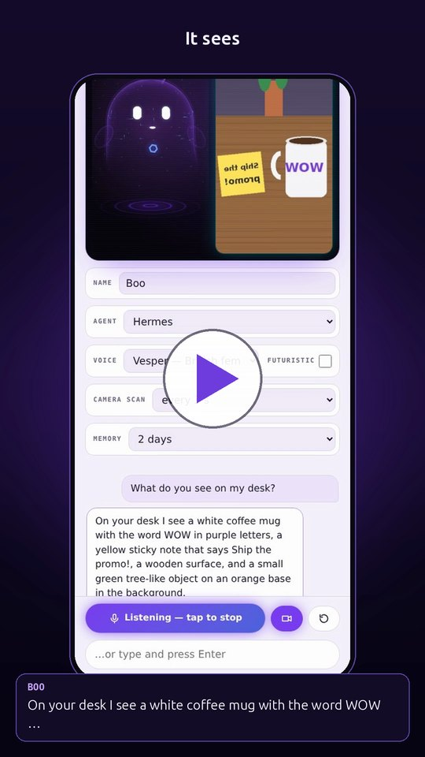</a>

▶ [Watch the 45-second demo](https://github.com/drowzeys/keys-ghost-machine-audio-visual-agent/blob/main/docs/media/promo-45s.mp4) (phone, 46 s, pauses trimmed)

**Boo** is a ghost-faced audio/visual agent you talk to in a browser. It hears you (Parakeet v3), answers out loud in
about half a second (Nemotron 3.5 Bolt and Fish Audio Drama 3), looks through your camera (Cosmos3-Edge), counts your
fingers exactly (MediaPipe hand tracking), remembers what it saw (Eyes of Kai), looks up live facts, and hands real
work to a back agent with tools (Hermes over ACP), asking out loud before anything that runs a command or writes. The
models run locally on TensorFold, on a Mac with Apple silicon or on an NVIDIA DGX Spark. A [lite voice](#lite-voice-kokoro-82m)
(Kokoro-82M) can stand in for Drama 3 where memory or disk is short.

Voices: [drowzeys/keys-ghost-machine-audio-visual-agent on Hugging Face](https://huggingface.co/drowzeys/keys-ghost-machine-audio-visual-agent)
(14 Drama 3 voices, Vesper is the default; the lite voice has Kokoro's stock voices, British bf_emma by default).

## Requirements

Two reference platforms, measured on the live stacks:

- **Linux on NVIDIA DGX Spark** (GB10, aarch64, CUDA 13, 128 GB unified memory).
- **macOS 26 on Apple silicon** (Metal).

| Component | Mac (memory) | DGX Spark (memory) | Disk |
|---|---|---|---|
| Nemotron 3.5 Bolt (TensorFold) | ≈ 45 GB | ≈ 31 GB | 24 GB |
| Drama 3 NVFP4 (TensorFold) | ≈ 28 GB wired (21 GB weights) | ≈ 21 GB | 21 GB |
| *or* Kokoro-82M, the [lite voice](#lite-voice-kokoro-82m) | ≈ 0.7 GB | ≈ 3.5 GB | ≈ 0.4 GB (+ its Python environment: ≈ 1 GB Mac, ≈ 5.5 GB Spark) |
| Cosmos3-Edge (TensorFold) | ≈ 2.8 GB | ≈ 3.5 GB | 2.4 GB converted (+7.2 GB original, needed only to convert) |
| Agent + Parakeet v3 | ≈ 3.1 GB (MLX) | ≈ 5.4 GB (NeMo) | ≈ 2.5 GB |
| Eyes of Kai | < 0.1 GB | < 0.1 GB | small |
| **Total** | **≈ 79 GB** | **≈ 61 GB** (+≈ 46 GB if weights are staged on /dev/shm for fast starts, optional) | **≈ 50 GB free** (≈ 57 GB while converting Cosmos) |
| **Total, lite voice** | **≈ 52 GB** | **≈ 44 GB** | **≈ 31 GB free** (Mac), **≈ 36 GB** (Spark); ≈ 9 GB more while converting Cosmos |

**Full or Lite.** The full voice is Drama 3; the [lite voice](#lite-voice-kokoro-82m) is Kokoro-82M. Everything else
(Bolt, Cosmos3-Edge, Parakeet, Eyes of Kai) is the same in both.

| | DGX Spark, Full | DGX Spark, Lite | Mac, Full | Mac, Lite |
|---|---|---|---|---|
| Platform | DGX Spark (GB10, 128 GB), Linux aarch64, CUDA 13 | same | Apple silicon, macOS 26+ | same |
| Minimum memory | 64 GB free | **48 GB free** | 96 GB unified | **64 GB unified** (tight, see below) |
| Recommended memory | a whole DGX Spark (≈ 101 GB in use with weights staged in memory) | a whole DGX Spark, with ≈ 40 GB left for other work | 128 GB or more | 96 GB or more |
| Free disk | ≈ 50 GB (≈ 57 GB while converting Cosmos) | ≈ 36 GB (≈ 45 GB while converting) | ≈ 50 GB (≈ 57 GB while converting Cosmos) | ≈ 31 GB (≈ 40 GB while converting) |
| Measured in use, whole stack | ≈ 101 GB | ≈ 62 GB | ≈ 64 GB | ≈ 55 GB |
| Voice engine alone | Drama 3 ≈ 42 GB | Kokoro ≈ 3.5 GB | Drama 3 ≈ 10 GB | Kokoro ≈ 0.7 GB |

- **Lite mainly saves memory on the DGX Spark** (about 39 GB of the stack in use). On a Mac it saves only about 9 GB:
  the floor there is Bolt (≈ 45 GB) plus Cosmos3-Edge (≈ 3 GB) and Parakeet (≈ 3 GB), about 52–55 GB before macOS.
- **A 64 GB Mac with Lite is tight and untested**: the stack needs about 55 GB, and macOS lets the GPU use only about
  three quarters of memory (≈ 48 GB) unless you raise the limit, e.g. `sudo sysctl iogpu.wired_limit_mb=57344`, which
  leaves macOS about 8 GB. Close other apps. 96 GB is the comfortable Mac minimum for Lite; Full needs 96 GB. Tested on
  an M5 Ultra with 256 GB.
- The DGX Spark figures are for everything on one node; the reference setup splits it over two. A lighter setup without
  the camera model or Eyes of Kai is not offered by the installer and was not measured.
- **What Lite gives up:** the 14 custom Drama 3 voices, voice cloning, Drama 3's expressiveness, and languages: Boo's
  lite voice speaks English only, so no German and none of the other European languages Drama 3 covers.
- **Software:** TensorFold 1.1.5 (release binaries for Bolt; the Drama 3 and Cosmos3 builds are described under
  Limitations), Python 3.11 or later, Node 22 or later for Eyes of Kai, and a browser with a microphone and camera.
  Safari on an iPhone works over HTTPS (for example through Tailscale Serve).
- **Optional:** the Hermes back agent and a deep model; any ACP agent or OpenAI-compatible model can take their place.

## One-shot install

One command on a DGX Spark or an Apple silicon Mac. It checks the machine against the requirements above, then installs
everything under `~/keys-ghost-machine`: the agent, the TensorFold 1.1.5 builds (checksums verified), a Python
environment, Eyes of Kai with its patch, the 14 voices and the models (Bolt, Drama 3 NVFP4, and Cosmos3-Edge converted
to TensorFold's 8-bit format), then starts Boo. No sudo. Run it again to resume or update; finished parts are skipped.

**DGX Spark** (Linux, GB10, CUDA 13):

```sh
curl -fsSL https://raw.githubusercontent.com/drowzeys/keys-ghost-machine-audio-visual-agent/main/install.sh | bash
```

**Mac** (Apple silicon, macOS 26+; install [Homebrew](https://brew.sh) first if you don't have Node 22):

```sh
curl -fsSL https://raw.githubusercontent.com/drowzeys/keys-ghost-machine-audio-visual-agent/main/install.sh | bash
```

The same script detects the platform. The first run downloads about 55 GB (Bolt 24 GB, Drama 3 22 GB, Cosmos3-Edge
7.2 GB to convert, then deleted) and takes a while; Parakeet v3 downloads itself the first time the agent starts.

### One-shot install, Lite (memory-constrained hardware)

The same installer with `--voice lite`: Kokoro-82M instead of Drama 3 (no Drama 3 download, about 22 GB less), for a
DGX Spark that shares its memory with other work or a Mac at the low end of the [requirements](#requirements).

**DGX Spark, Lite** (Linux, GB10, CUDA 13; about 48 GB free memory):

```sh
curl -fsSL https://raw.githubusercontent.com/drowzeys/keys-ghost-machine-audio-visual-agent/main/install.sh | bash -s -- --voice lite
```

**Mac, Lite** (Apple silicon, macOS 26+; 96 GB unified memory comfortable, 64 GB tight):

```sh
curl -fsSL https://raw.githubusercontent.com/drowzeys/keys-ghost-machine-audio-visual-agent/main/install.sh | bash -s -- --voice lite
```

`--voice both` installs both voices and adds a Full/Lite switch to the page; `kgm voice full|lite|both` switches later.
A 64 GB Mac also needs the GPU memory limit raised as described under [Requirements](#requirements); the installer
says so.

**Docker, Lite (DGX Spark):** no Drama 3 mount, `-e VOICE_ENGINE=lite` (image 0.2.0 or later; see
[docker/README.md](docker/README.md)):

```sh
docker run --gpus all --rm -p 8095:8095 -e VOICE_ENGINE=lite \
  -v ~/keys-ghost-machine/models/NVIDIA-Nemotron-3.5-Bolt-74B-A9B-24GB:/models/bolt \
  -v ~/keys-ghost-machine/models/cosmos3-tf:/models/cosmos3 -v ~/models/hf-cache:/models/hf-cache -e KAI=1 \
  ghcr.io/drowzeys/keys-ghost-machine-audio-visual-agent:0.3.0
```

| Setting | What it does | Default |
|---|---|---|
| `KGM_VOICE` | `full` (Drama 3), `lite` (Kokoro-82M) or `both`; same as `--voice`; a re-run keeps the last choice | `full` |
| `KGM_HOME` | Install folder | `~/keys-ghost-machine` |
| `KGM_MODELS` | Model folder | `$KGM_HOME/models` |
| `KGM_BOLT_DIR`, `KGM_DRAMA_DIR`, `KGM_COSMOS_DIR` | Use model folders you already have (Cosmos3: an already converted one) | in `KGM_MODELS` |
| `KGM_PORT_BASE` | Move all ports: base+1 Bolt, +8 (Mac) or +3 (Spark) Drama, +9 Cosmos3, +5 page, +70 Kai, +107 Kokoro | 8091, 8098/8093, 8099, 8095, 3870, 8197 |
| `KGM_START=0` | Install without starting | starts |
| `KGM_KEEP_SRC=1` | Keep the original Cosmos3-Edge download after converting | deleted |
| `KGM_FORCE=1` | Install even if the memory or disk check fails | refuses |
| `HF_TOKEN` | Hugging Face token, if you have one | not needed |

Settings go in front of `bash`, for example `curl -fsSL …/install.sh | KGM_HOME=/data/boo bash`.

**Run it** with `kgm` (linked into `~/.local/bin` when that folder exists, otherwise `~/keys-ghost-machine/bin/kgm`):

| Command | Does |
|---|---|
| `kgm start` | Starts Bolt, the voice (Drama 3 and/or Kokoro), Cosmos3-Edge, Eyes of Kai and the agent, waiting for each to answer |
| `kgm stop` | Stops them |
| `kgm restart [service]` | Restarts everything, or one of `bolt drama kokoro cosmos kai agent` |
| `kgm status` | Shows which parts are up, on which ports |
| `kgm logs [service]` | Follows a log (the agent's by default) |
| `kgm url` | Prints the page address and the Tailscale line for your phone |
| `kgm voice full\|lite\|both` | Switches the voice engine and restarts what changes (the engine must be installed: re-run the installer with `--voice`) |

Then open `http://127.0.0.1:8095/`. For your phone, put both on [Tailscale](https://tailscale.com) and run once
`tailscale serve --bg --https=8443 http://127.0.0.1:8095`; open `https://<this-machine>.<your-tailnet>.ts.net:8443`.
If `hermes` is on your PATH the installer wires it in as the back agent; otherwise `~/keys-ghost-machine/agents.example.json`
shows what to add to `~/keys-ghost-machine/profile.json`.

**Docker instead (DGX Spark):** after the installer has fetched the models (`KGM_START=0`), or with your own copies:

```sh
docker run --gpus all --rm -p 8095:8095 \
  -v ~/keys-ghost-machine/models/NVIDIA-Nemotron-3.5-Bolt-74B-A9B-24GB:/models/bolt \
  -v ~/keys-ghost-machine/models/drama-3-NVFP4-Pruned:/models/drama \
  -v ~/keys-ghost-machine/models/cosmos3-tf:/models/cosmos3 -e KAI=1 \
  ghcr.io/drowzeys/keys-ghost-machine-audio-visual-agent:0.3.0
```

`-e VOICE_ENGINE=lite` (no Drama mount needed) or `both` picks the voice (see [docker/README.md](docker/README.md)).

**Uninstall:** `kgm stop && rm -rf ~/keys-ghost-machine ~/.local/bin/kgm` (add `~/.cache/huggingface` if nothing else
uses its downloads).

## Lite voice (Kokoro-82M)

Drama 3 is the full voice: expressive, with the 14 custom voices, and the part of the stack that takes the most memory
after Bolt. The lite voice swaps it for [Kokoro-82M](https://huggingface.co/hexgrad/Kokoro-82M) (hexgrad, Apache-2.0),
an 82-million-parameter speech model, behind the same API (`voice_agent/kokoro_server.py`: MLX on the Mac through
mlx-audio, PyTorch CUDA on the DGX Spark). Everything else in Boo stays the same.

Measured on the live stacks with the same 16 questions and the same client:

| | DGX Spark, lite | DGX Spark, full | Mac, lite | Mac, full |
|---|---|---|---|---|
| Voice-to-voice, median | **0.33–0.40 s** | 0.55–0.77 s | 0.49–0.64 s | 0.47–0.60 s |
| Voice engine memory | **≈ 3.5 GB** | ≈ 42 GB | **≈ 0.7 GB** | ≈ 10 GB |
| Whole stack in use | **≈ 62 GB** | ≈ 101 GB | **≈ 55 GB** | ≈ 64 GB |
| Voice engine on disk | ≈ 0.4 GB | 21 GB | ≈ 0.4 GB | 21 GB |

These are memory in use while talking, read from the running stacks (the DGX Spark one with its weights staged in
memory); the [Requirements](#requirements) table counts what each part needs at load.

Kokoro is not autoregressive: a sentence's audio comes all at once, about 50–90 ms for a short first chunk on the
Spark's GPU, so it needs no keep-warm (profiles set `keep_warm: false` for it). Its leading ~250 ms of silence is cut.

**How to choose.** Take the full voice (Drama 3) when you have the memory: it sounds more alive, it has the 14 voices
made for Boo and it speaks more languages. Take the lite voice on a DGX Spark that shares its memory with other work,
when disk is short, or when you want the fastest replies on a Spark; take `both` to compare them in the page.

**What lite gives up:**

- The 14 custom Drama 3 voices and voice cloning; Kokoro has its own stock voices only.
- Drama 3's expressiveness, and the more expressive delivery still to come on it; Kokoro reads evenly.
- Languages: Boo's lite voice speaks English only (American and British voices). Kokoro itself also has Spanish,
  French, Italian, Portuguese, Hindi, Japanese and Mandarin voices, but no German; Drama 3 covers more, German included.

**Voices.** `bf_emma` (British female, warm and clear) is the default. Also offered: `bf_isabella`, `bf_alice`,
`bf_lily`, `bm_george`, `bm_fable`, `bm_lewis`, `bm_daniel` (British), `af_heart` (Kokoro's best-rated voice),
`af_bella`, `af_nicole`, `af_sarah`, `am_michael`, `am_fenrir`, `am_puck` (American). Previews of a few are in the
[Hugging Face repo](https://huggingface.co/drowzeys/keys-ghost-machine-audio-visual-agent/tree/main/previews/kokoro).

**Turning it on:** `install.sh --voice lite` (or `both`), `kgm voice lite` on an install that has it, `VOICE_ENGINE=lite`
for Docker, or by hand `./serve-kokoro.sh` then `./serve.sh profiles/mac.json lite` (see [Profiles](#profiles)).

## See it work

[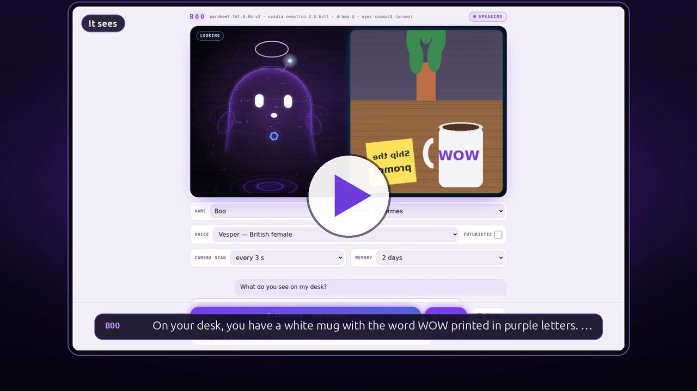](https://github.com/drowzeys/keys-ghost-machine-audio-visual-agent/blob/main/docs/media/promo-landscape.mp4)

Real recordings of the page, hands-free: [landscape, 1920×1080, 90 s](https://github.com/drowzeys/keys-ghost-machine-audio-visual-agent/blob/main/docs/media/promo-landscape.mp4) (above, the
[phone cut, 1080×1920, 46 s](https://github.com/drowzeys/keys-ghost-machine-audio-visual-agent/blob/main/docs/media/promo-45s.mp4)). The voices are synthetic Drama 3 voices and the desk is a
computer-made scene; no person appears.

## Screenshots

| Phone (camera on) | Desktop |
|---|---|
| 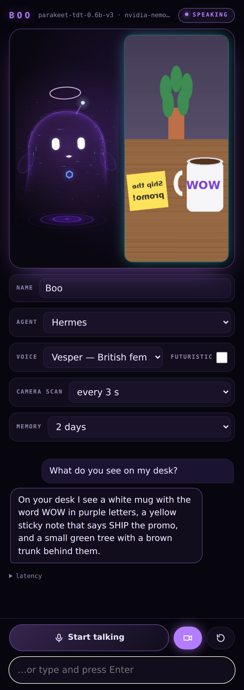 | 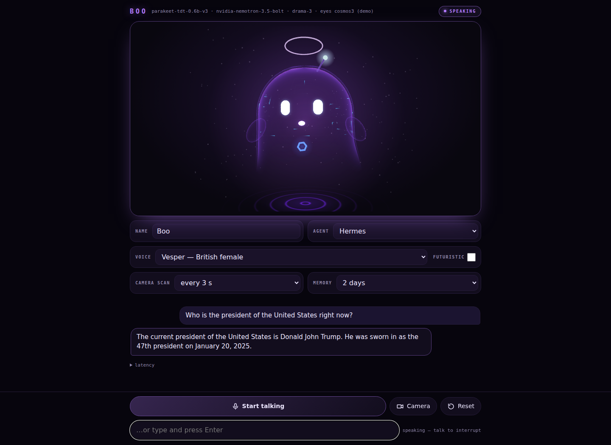<br><br>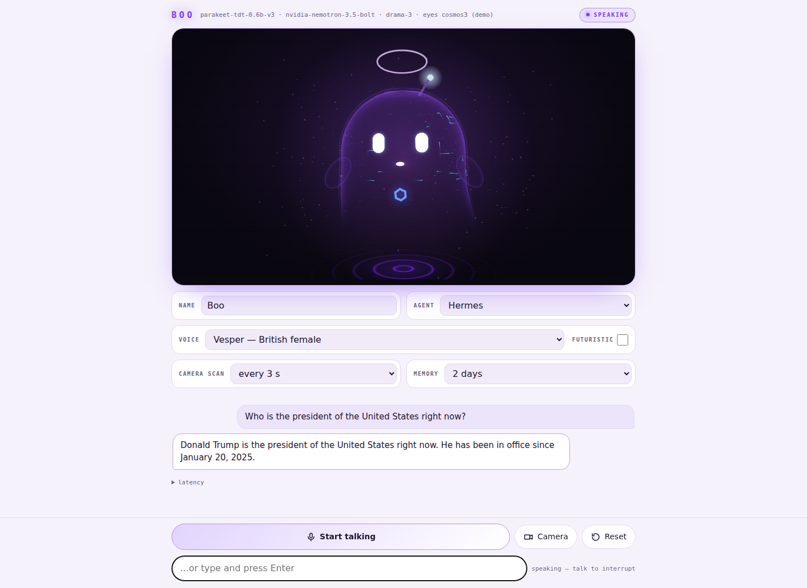 |

A task handed to Hermes: the card shows only the tool's name while it works, then the answer.

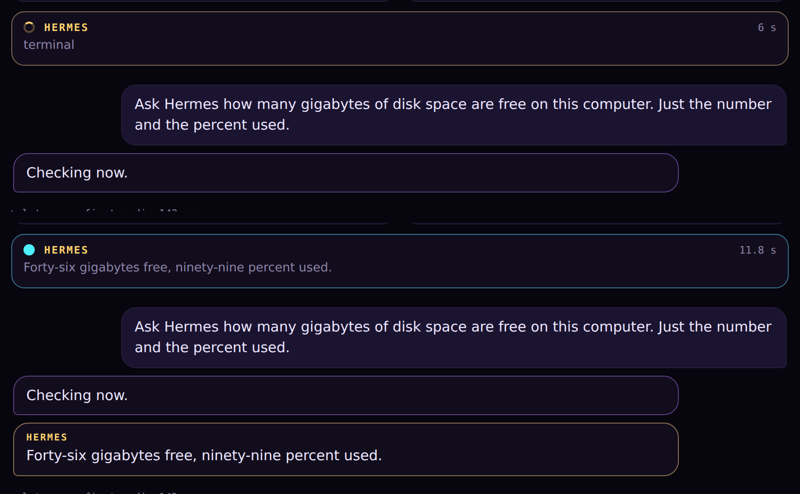

## What happens in a turn

Every spoken turn goes through one router. Quick paths answer in the same turn; only real tasks go to the back agent.

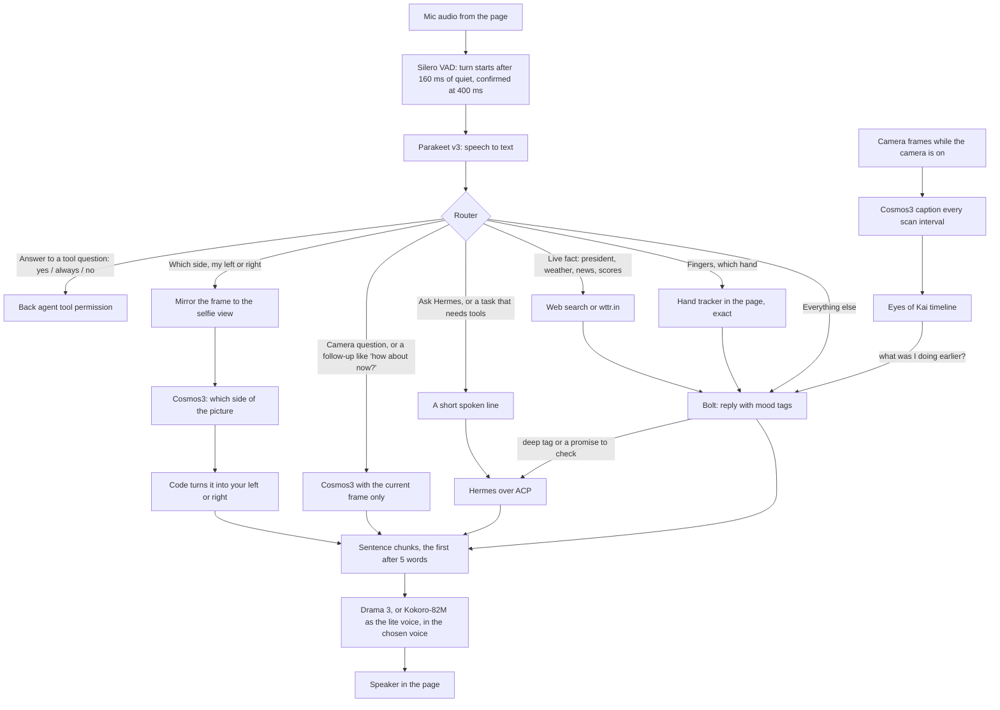

Rules that make it behave:

- **Camera answers are about the current frame only.** The camera model gets a short instruction and this question,
  with no conversation history and no older caption, so it cannot repeat an earlier answer. A short follow-up to a
  camera turn ("how about now?", "are you sure?", "look again") looks at the live frame again, carrying the original
  question.
- **The person in the picture is "you".** The camera model is told the picture shows the user, never itself.
- **Selfie left and right.** Cosmos3 was trained on first-person robot cameras: it knows which side of a picture a thing
  is on, but not your sides on a face-forward camera. So the agent mirrors the frame to your own view, asks only for
  the picture side, and says it as your side in code.
- **Fingers and hands come from the hand tracker**, never the camera model, which miscounts them.
- **The back agent gets only your words** (plus camera or hand facts when used), never the front brain's lines. A reply
  that only promises to check is sent back once to answer.
- **Back-agent tools need a spoken yes.** Read and search tools run freely; anything that runs a command, writes or
  sends asks first, out loud and on the page.
- **Mood tags** such as `[happy]` drive the ghost's face and are never spoken.

## Measured speed

Voice-to-voice is the end of your speech to the first sound of the reply, measured by a client streaming 16 recorded
questions in real time (spoken by macOS voices), on TensorFold 1.1.5; on the Mac Drama 3 runs on the keys 1.1.4
engine (see [What's new in v0.3.0](#whats-new-in-v030)).

| Measure | Mac (M5 Ultra) | DGX Spark |
|---|---|---|
| Voice-to-voice, median, Full (Drama 3) | 0.45–0.71 s | 0.47–0.55 s |
| Voice-to-voice, median, Lite (Kokoro) | 0.53–0.57 s | — |
| Speech recognition (Parakeet v3) | 72–82 ms | 86 ms |
| Nemotron 3.5 Bolt, first token | 60–80 ms | 59 ms |
| Drama 3 first audio, named voice (Vesper) | 60–80 ms | 121 ms |
| Cosmos3 camera answer, first token / full | 78 ms / 0.25–0.32 s | 101–103 ms / 0.33 s |
| Camera question, voice starts | 0.37–0.46 s | 0.60–0.73 s |
| Left / right question, voice starts | 0.26–0.31 s | 0.55–0.74 s |
| Live fact (search or weather), voice starts | 1.3–3.8 s | ≈ 2.6 s |
| Back-agent task with tools | 30–50 s | 30–50 s |

The Mac's Drama 3 first audio is with the engine warm, as in a conversation (Boo keeps it warm while you speak):
58–68 ms over 10 short lines with the keys Metal build (67–79 ms in the v0.3.0 checks across four voices); after a
second or more idle the first line takes about 125 ms. Bolt's first token is 77–81 ms on 1.1.5 and 79–80 ms on 1.1.4
in the same bench (the voice profile's system prompt, short spoken questions).

On TensorFold 1.1.3 the DGX Spark measured 0.92–0.95 s voice-to-voice, with Drama 3 first audio in Vesper at 415 ms
and Bolt's first token at 95 ms.

**What TensorFold 1.1.5 brought:** NVFP4 pruned Drama 3 on Metal (#1268), reuse of a voice's reference prefill
(#1237) and voice descriptions in `/v1/voices` (#1270), upstream. **What is still ours** on 1.1.5: Bolt on Metal,
128 Drama 3 prompt rows a Metal round, the Cosmos3-Edge ports, and the Mac's Drama 3 engine itself (the 1.1.4-keys.1
build, whose voice-prefix cache keeps every voice: 67–79 ms first audio against 107–343 ms for stock 1.1.5 on Metal).

**What TensorFold 1.1.4 brought:** Drama 3 prompt rows in chunks on CUDA (`TF_DRAMA_PREFILL_ROWS`), idle unload
(`--idle-unload`), a `/health` that turns 503 on a dead CUDA context, and attested voice catalogs upstream.
**What was still ours on 1.1.4** (in the [prebuilt builds](#prebuilt-builds)): Bolt on Metal, NVFP4 pruned Drama 3 experts, the
voice-prefix cache, and the Cosmos3-Edge ports for Metal and CUDA. The DGX Spark's Drama 3 still runs on
plotarmordev's NVFP4 fork, because stock 1.1.4 refuses the pruned checkpoint.

**Fast short replies no longer deafen a session.** A quick reply such as "I'm on it." could finish before the
person's silence was confirmed; letting it out then marked Boo as still speaking after the reply had ended, and the
session stopped listening. Boo now clears that state when the reply is already done (found with the lite voice, whose
short replies finish fastest; since the fix every turn was heard: 64 of 64 in testing, 20 of 20 in an install test).

**Long lines that go quiet.** Drama 3 sometimes speaks the first sentence of a long line and then only silence or a
flat hum near −36 dBFS until the frame cap, on about 1 in 5 paragraph-length inputs, and the same input every time
(the seed comes from the prompt; [ashhart/TensorFold#1275](https://github.com/ashhart/TensorFold/issues/1275)). It is
the model's sampling, not a TensorFold bug, and 1.1.3 does the same. `kgm` and the Docker image start Drama 3 with 1.1.4's
silence guard: `--silence-floor-dbfs=-30 --silence-seconds=4 --silence-mid-s=2 --silence-mid-min-voiced-s=1
--silence-redraws=3 --silence-redraw-budget-s=90` (whole replies are redrawn; good takes stay byte-identical; on the
DGX Spark since v0.2.0, whose NVFP4 engine gained the guard's flags). The
guard never redraws a stream, so Boo also checks each streamed
take itself: after 3 s under −30 dBFS it drops the quiet tail and asks for the text after the last sentence spoken
(a new text draws a new seed). On 12 paragraphs the stalled one came back whole in one extra request, and the other
11 were byte-identical with the check on.

## Settings in the page

- **Name**: what the assistant is called (Boo by default); it answers to it, and the header follows.
- **Agent**: the back agent (Hermes over ACP, or a direct OpenAI-compatible model).
- **Voice engine** (only when both are running, `--voice both`): Full (Drama 3) or Lite (Kokoro-82M), per
  conversation; each remembers its own voice on the device.
- **Voice**: any voice the voice engine offers (Drama 3's loaded voices, or Kokoro's), with its description;
  **Futuristic** adds a light chorus, a short airy echo and a treble lift in the browser (no server cost).
- **Camera scan**: how often the camera is captioned into memory while the camera is on: every 1, 2, 3 (default), 5,
  10 or 30 seconds, or every 1, 5 or 15 minutes.
- **Memory**: how long captions are kept: 1, 2 (default), 3 or 5 days, or 1 week.

## Video panel

The page has three columns: your camera on the left (a local preview only, never recorded or used in a video), Boo
in the middle, and a **video panel** on the right. On a phone they stack, with Boo first. Both side panels fold away.

The video panel makes keyframes with the headless
[Imagination Studio](https://github.com/drowzeys/Imagination-Studio-by-keys-Wasserman) and clips with the FP4 clip
worker (MiniMax H3 as FastH3 V2 on FastVideo), whose Community License excludes the USA, the EU, the UK and South Korea
unless MiniMax authorizes the use. You can use the panel's Start and Stop buttons, or ask by voice: "Boo, make a video of a lighthouse in a
storm", "make an endless video of waves", "stop the video", "show me the last clip".

While a clip renders, the panel shows it live. Today's Studio reports the sampler's steps but sends no pictures, so the
live view is labelled "progress only". When the clip is done, it plays (muted unless you turn sound on, and always quiet
while Boo listens or speaks), and the next clip's render follows. "Keep going" plans each next clip with Bolt from the
story so far, and opens it on the last clip's final frame. The film downloads as one file. Runs are checkpointed clip by
clip, so a restart resumes where it stopped.

### The look: Natural, HDR, Neon, Sonar

What you watch can carry a finish (`gma/look.py`). Four chips under the panel (and beside "Download film" on the
Multiverse page) pick it; so does the voice or a typed line: "neon look", "make it HDR", "sonar reveal", "natural colours", "turn the
look off". "Change the look" offers the four, and the next words pick one.

- **Natural**: the clip as the model made it.
- **HDR**: the Imagination Studio's HDR finish (its `hlg` job): real HDR, BT.2020 / HLG in 10-bit HEVC, bright and
  contrasty, with an SDR copy.
- **Neon**: a colour table first (`gma/neon.py`: greys go to cobalt blue in the dark and to hot red and magenta in the
  light, colours that are strong already keep their hue and get stronger), then the same HDR finish at 0.6 strength.
- **Sonar**: the sonar reveal (`gma/sonar.py`). The clip is dark and black-and-white until pulses of echolocation leave
  its subject and run over the surfaces of the scene, leaving it in the HDR look's colour, with a sonar ping at each
  pulse. The wave is not a circle on the picture: every frame's depth is estimated (Depth Anything V2, the metric
  outdoor Small model), and the wave reaches a pixel when it has travelled that pixel's distance from the subject in
  space, so it crosses a body, wraps a bus, runs along the road and climbs a wall. A 10 s clip gets two pulses and a
  20 s film four; an early pulse's colour dies back, the last one stays. It takes about a minute and a half for a 10 s clip at
  1376x768 on a DGX Spark, in its own process (`gma/sonar_worker.py`: numpy, and torch with transformers for the depth; the model, about 100 MB, is
  fetched from Hugging Face on first use). `"look": {"sonar": {...}}` in a profile sets `python` (the interpreter that
  has those packages), `at` (`[x, y]` of the picture, 0..1, where the pulses leave from; by default the nearest thing in
  the middle of the picture), `far`, `speed` and `dist`.

The finish is a copy beside the clip or the film, made in the background (CPU and ffmpeg, about a minute for a 10 s
clip at 1376x768 on a DGX Spark); the plain clip plays until it is there, then the page switches to it. A screen that
shows HDR and plays HEVC gets the HDR copy, any other the SDR copy. The clips the work goes on from are never touched:
a clip that continues another still opens on its plain last frame, and AutoPilot checks plain pictures. The look is
kept across restarts. A profile changes a look's strength with `"look": {"neon": {"strength": 0.8}}` and turns the whole
feature off with `"look": false`. Not covered yet: the clips inside the Multiverse tree and the Invisible timeline play
plain; only their exported film takes the look.

A profile turns it on with a `video` section. A run is refused when the render host would be the machine running the
voice models and that machine lacks room. The full design, including what the engines expose for live previews and the
plan for the infinity engine, is in [docs/video-panel.md](docs/video-panel.md).

## Prebuilt builds

The [v0.3.0 release](https://github.com/drowzeys/keys-ghost-machine-audio-visual-agent/releases/tag/v0.3.0) has
unofficial community builds of TensorFold 1.1.5 with everything Boo needs that upstream does not ship yet:

- `keys-boo-tensorfold-1.1.5-macos-arm64.tar.gz`: for Apple silicon, `tensorfold-native` (TensorFold 1.1.5) that
  serves Nemotron 3.5 Bolt (with `libbolt.dylib`) and Cosmos3-Edge on Metal, and `tensorfold-drama`, the unchanged
  1.1.4-keys.1 engine for Drama 3 NVFP4 with named voices (128 prompt rows a GPU round, a voice-prefix cache that keeps
  every voice, the silence guard), which starts speaking faster on Metal than stock 1.1.5.
- `keys-boo-tensorfold-1.1.5-linux-aarch64.tar.gz`: for a DGX Spark, `tensorfold-cosmos3` (Cosmos3-Edge on CUDA) and
  `tensorfold-drama3-nvfp4` (Drama 3 NVFP4 with the voice-prefix cache and the silence guard flags; unchanged, as
  stock 1.1.5 still does not load the pruned checkpoint on CUDA). Bolt uses the stock
  [TensorFold 1.1.5](https://github.com/ashhart/TensorFold/releases/tag/v1.1.5) release.

Each archive has its own README with run commands, a change list, the licences and `SHA256SUMS`. The source is
[drowzeys/TensorFold](https://github.com/drowzeys/TensorFold), branches `bolt-metal-115`, `drama3-metal-voices-115`,
`cosmos3-metal-115`, `cosmos3-cuda-115`, `bolt-metal-114` (the Mac's Drama 3 engine) and `drama3-cuda-voices-guard` (`drama3-cuda-voices` plus the guard).

**Docker (DGX Spark):** the whole Spark stack in one image, without model weights
(about 25 GB, built on NVIDIA's PyTorch container):

```sh
docker pull ghcr.io/drowzeys/keys-ghost-machine-audio-visual-agent:0.3.0
docker run --gpus all --rm -p 8095:8095 \
  -v ~/models/bolt:/models/bolt -v ~/models/drama:/models/drama -v ~/models/cosmos3:/models/cosmos3 \
  -v ~/models/hf-cache:/models/hf-cache -e KAI=1 \
  ghcr.io/drowzeys/keys-ghost-machine-audio-visual-agent:0.3.0
```

Add `-e VOICE_ENGINE=lite` (and drop the Drama mount) for the lite voice, or `-e VOICE_ENGINE=both` for the Full/Lite
switch.

Mounts and settings are in [docker/README.md](docker/README.md).

## Manual setup

What the one-shot installer does, by hand:

1. **Engines (TensorFold).** Serve, each on its own port:
   - Nemotron 3.5 Bolt with the TensorFold 1.1.5 release (`tensorfold serve … --no-thinking --context 32768`), on
     `:8091`.
   - Drama 3 NVFP4 with named voices: `--voices ~/voices/<mac|spark> --default-voice vesper` (voices from the Hugging
     Face repo), on `:8098` (Mac) or `:8093` (Spark). On a build with 1.1.4's silence guard add
     `--silence-floor-dbfs=-30 --silence-seconds=4 --silence-mid-s=2 --silence-mid-min-voiced-s=1 --silence-redraws=3
     --silence-redraw-budget-s=90` (see [Measured speed](#measured-speed)).
   - Cosmos3-Edge with `--vision` and `--keep-warm 0`, on `:8099`.
   - Or, for the lite voice instead of (or beside) Drama 3: Kokoro-82M in its own environment, on `:8197`:
     ```sh
     python3 -m venv kokoro-venv
     kokoro-venv/bin/pip install -r requirements-kokoro-mac.txt   # Spark: install CUDA 13 PyTorch first, then requirements-kokoro-spark.txt
     ./serve-kokoro.sh                                            # KOKORO_VOICE=af_heart picks another default
     ```
2. **Eyes of Kai.** Clone [tonyd2wild/eyes-of-kai](https://github.com/tonyd2wild/eyes-of-kai), apply
   `patches/eyes-of-kai-retention.patch` (`git apply`), set `PORT=3870` and `BIND_HOST=127.0.0.1` in its `.env`, and
   start it with Node 22 (`node src/server.js`).
3. **The agent.**
   ```sh
   python3 -m venv venv
   venv/bin/pip install -r requirements-mac.txt      # or requirements-spark.txt on a DGX Spark
   cp profiles/mac.example.json profiles/mac.json   # edit ports, voices folder and back agents
   ./serve.sh profiles/mac.json                     # add "lite" or "both" for the lite voice
   ```
   Open `http://127.0.0.1:8095/`. For a phone, serve it over HTTPS (browsers only give the microphone and camera to
   secure pages), for example with `tailscale serve --https=8443 http://127.0.0.1:8095`.
4. **Back agent (optional).** The example profile starts `hermes acp` locally. To use one on another machine, set its
   `command` to `["ssh", "-T", "user@host", "hermes", "acp"]`. The `deep` agent is any OpenAI-compatible endpoint.

`python -m voice_agent.bench ws://127.0.0.1:8095/ws a.wav b.wav …` measures voice-to-voice from spoken questions as
16 kHz mono WAV files (any voice engine's sample rate; `--agent NAME` hands deep requests to another back agent, for
example a tool-free one, while measuring). No recordings ship with the repository; make test questions with a synthetic Drama 3 voice, for
example:

```sh
curl -s http://127.0.0.1:8098/v1/audio/speech -H 'Content-Type: application/json' \
  -d '{"model": "drama-3", "voice": "oliver", "input": "What is the weather like today?", "response_format": "wav"}' -o q.wav
ffmpeg -y -i q.wav -ac 1 -ar 16000 a.wav
```

## Profiles

A profile names each engine and the turn timing:

- `asr`: `parakeet-mlx` (Mac) or `nemo` (Spark) with the model id.
- `brain`: the front model's URL, model name, system prompt and sampling.
- `voice`: the Drama 3 URL, default voice, voices folder (for previews and descriptions) and `first_words` (the first
  spoken chunk is cut after this many words). `keep_warm: false` stops the warm-up requests (for an engine that starts
  at once). Drama 3 serves two speech streams at once (TensorFold `--parallel`, default 2) and answers a third with
  503, so warm-ups never run while something is being said, and a refused line is asked again for up to `retry_s`
  seconds (default 6) instead of being lost.
- `voice_engine`: `full` (default), `lite` or `both`; `--voice` on the command line or `VOICE_ENGINE` overrides it.
  `voice_lite` changes the lite voice's settings (default: Kokoro-82M at `http://127.0.0.1:8197/v1`, voice `bf_emma`,
  no keep-warm).
- `turn`: VAD timing (`eager_silence_ms` starts work early, `end_silence_ms` confirms the end of a turn).
- `eyes`: the camera model; `memory`: Eyes of Kai's URL, the captioner and `interval_s`.
- `agents` and `agent`: the back agents and the default one.
- `video` (optional): the video panel (`renderer`: `studio-headless`), clip settings (`seconds`, `max_clips`,
  `keyframe`) and spoken updates ([docs/video-panel.md](docs/video-panel.md#profile)).

## Limitations

- **Cosmos3-Edge on TensorFold** needs the Cosmos3 ports (a new Metal model family and its CUDA counterpart), which are
  not in TensorFold's upstream releases yet; use the [prebuilt builds](#prebuilt-builds). Without them, point `eyes`
  and `memory.captioner` at any OpenAI-compatible vision model that accepts PNG images.
- **Drama 3 on the Mac** runs on the keys 1.1.4-keys.1 engine (`bin/tensorfold-drama` in the Mac archive): NVFP4
  pruned experts on Metal, a voice-prefix cache that keeps every voice, and 128 prompt rows a GPU round (offered
  upstream in [plotarmordev/TensorFold #1](https://github.com/plotarmordev/TensorFold/pull/1)). Stock TensorFold 1.1.5
  reads the pruned checkpoint on Metal too (#1268, #1237) but starts speaking later (107–343 ms against 67–79 ms). The
  **DGX Spark** runs Drama 3 with [plotarmordev's TensorFold fork](https://github.com/plotarmordev/TensorFold) plus
  a voice-prefix cache and the silence guard flags; stock TensorFold 1.1.5 does not load the NVFP4 pruned
  checkpoint on CUDA yet.
- Free-form camera descriptions ("describe what you see") can still name a side wrongly; questions about a side go
  through the reliable path above.
- Live facts come from web search snippets, which can be out of date; ask the back agent for anything that needs
  digging.
- Fish Audio's licence applies to Drama 3 speech: hosted services that generate speech for third parties need a
  separate licence from Fish Audio. Kokoro-82M is Apache-2.0.
- The lite voice is English only in Boo, has no mood in its delivery, and cannot clone or use the Drama 3 voices.

## Questions and issues

Please use [GitHub Issues](https://github.com/drowzeys/keys-ghost-machine-audio-visual-agent/issues).

## Licence

The code is MIT (LICENSE). Everything below keeps its own licence.

## Credits

| Component | What it does in Boo | Author / org | Licence | Link |
|---|---|---|---|---|
| Nemotron 3.5 Bolt | The front brain: answers most turns, with mood tags for the face | NVIDIA | NVIDIA Open Model License | [Hugging Face](https://huggingface.co/nvidia/NVIDIA-Nemotron-3.5-Bolt-74B-A9B-24GB) |
| Cosmos3-Edge | Camera questions and memory captions (its reasoner tower) | NVIDIA | OpenMDW 1.1 | [Hugging Face](https://huggingface.co/nvidia/Cosmos3-Edge) |
| Parakeet TDT 0.6B v3 | Speech to text | NVIDIA | CC-BY-4.0 | [Hugging Face](https://huggingface.co/nvidia/parakeet-tdt-0.6b-v3) |
| parakeet-mlx | Runs Parakeet on the Mac | senstella | Apache-2.0 | [GitHub](https://github.com/senstella/parakeet-mlx) |
| NeMo | Runs Parakeet on the DGX Spark | NVIDIA | Apache-2.0 | [GitHub](https://github.com/NVIDIA/NeMo) |
| Drama 3 | The voice (speech synthesis); the 14 named voices are takes of its built-in voice | Fish Audio | Fish Audio Community License | [Hugging Face](https://huggingface.co/fishaudio/drama-3) |
| drama-3-NVFP4-Pruned, NVFP4 CUDA fork and named voices | The 4-bit pruned Drama 3 checkpoint, the DGX Spark's Drama engine and `--voices` | plotarmordev | Fish Audio Community License (weights) · Apache-2.0 (engine) | [checkpoint](https://huggingface.co/plotarmordev/drama-3-NVFP4-Pruned) · [fork](https://github.com/plotarmordev/TensorFold) |
| TensorFold | The engine for Bolt, Drama 3 and Cosmos3-Edge, on Metal and CUDA | Ash Hart | Apache-2.0 | [GitHub](https://github.com/ashhart/TensorFold) |
| Kokoro-82M | The lite voice (optional, instead of Drama 3) | hexgrad | Apache-2.0 | [Hugging Face](https://huggingface.co/hexgrad/Kokoro-82M) |
| kokoro | Runs Kokoro-82M on PyTorch (DGX Spark) | hexgrad | Apache-2.0 | [GitHub](https://github.com/hexgrad/kokoro) |
| mlx-audio | Runs Kokoro-82M on MLX (Mac); weights from `mlx-community/Kokoro-82M-bf16` | Prince Canuma (Blaizzy) | MIT | [GitHub](https://github.com/Blaizzy/mlx-audio) |
| misaki | Kokoro's text-to-phoneme step (G2P) | hexgrad | Apache-2.0 | [GitHub](https://github.com/hexgrad/misaki) |
| spaCy and en_core_web_sm | English tokenising and tagging inside misaki | Explosion | MIT | [GitHub](https://github.com/explosion/spaCy) |
| espeak-ng (through phonemizer-fork and espeakng-loader) | misaki's fallback pronunciation for words its dictionary lacks | espeak-ng contributors | GPL-3.0 | [GitHub](https://github.com/espeak-ng/espeak-ng) |
| StyleTTS 2 | The architecture Kokoro-82M is built on (with an iSTFTNet decoder) | Yinghao Aaron Li et al. | MIT | [GitHub](https://github.com/yl4579/StyleTTS2) |
| Eyes of Kai | The continuity log: timestamped captions so Boo can answer about the past | tonyd2wild | MIT | [GitHub](https://github.com/tonyd2wild/eyes-of-kai) |
| Hermes Agent | The back agent with tools and skills, over ACP | Nous Research | see repository | [GitHub](https://github.com/NousResearch/hermes-agent) |
| qwen-audio-agent | Design inspiration: the frontstage/backstage split (a fast voice in front, a tool-using agent behind that reports back); no code from it is used | Qwen Audio team | Apache-2.0 | [GitHub](https://github.com/QwenAudio/qwen-audio-agent) |
| RED-SNOW 5.3 Flash | The back agent's model in the reference setup (a GLM-5.3-Flash build); any OpenAI-compatible model works | RED-SNOW | see model card | — |
| Silero VAD v5 | Hears when someone is speaking (`silero_vad.onnx` ships here) | Silero | MIT | [GitHub](https://github.com/snakers4/silero-vad) |
| MediaPipe Face Detector and Hand Landmarker | Gaze tracking, exact finger counts and which hand, in the page | Google | Apache-2.0 | [GitHub](https://github.com/google-ai-edge/mediapipe) |
| Three.js | Boo, the 3D ghost | three.js authors (mrdoob) | MIT | [GitHub](https://github.com/mrdoob/three.js) |
| Imagination Studio | Draws the video panel's keyframes and the film's narration and score, headless | keys and Sam Wasserman | see repository | [GitHub](https://github.com/drowzeys/Imagination-Studio-by-keys-Wasserman) |
| MiniMax H3 (FastH3 on a DGX Spark) | The video model behind every clip (FastH3 V2 on FastVideo); Boo ships no weights | MiniMax | MiniMax H3 Community License (excludes the USA, EU, UK and South Korea without MiniMax authorization) | — |
| ComfyUI | Runs the Studio's keyframe and sound jobs on a DGX Spark | Comfy Org | GPL-3.0 | [GitHub](https://github.com/comfyanonymous/ComfyUI) |
| HyperFlow-Infinity and Echo-Infinity | The idea behind the panel's continue mode and AutoPilot's scene memory; no code from either is in this repository | Video Rebirth; Yuxuan Bian, Nan Duan, Qiang Xu et al. | Apache-2.0 (HyperFlow-Infinity) | [GitHub](https://github.com/Video-Rebirth/hyperflow-infinity) |
| FastVideo | Every clip: FastH3 V2 NVFP4 on its FP4 sparse-attention recipe, in the clip worker's own venv (unmodified, commit a01c50a8) | Hao AI Lab | Apache-2.0 | [GitHub](https://github.com/hao-ai-lab/FastVideo) |
| FastH3 V2 NVFP4-Consumer | The clip model (8-step distilled MiniMax H3, NVFP4 Qwen3-VL encoder, LynnReal's light VAE, AdaLN tables) | FastVideo (Hao AI Lab) | see its model card | [Hugging Face](https://huggingface.co/FastVideo/FastVideo-FastH3-8-Step-V2-NVFP4-Consumer) |
| FlashInfer | The clip worker's NVFP4 quantize and GEMMs | FlashInfer team | Apache-2.0 | [GitHub](https://github.com/flashinfer-ai/flashinfer) |
| FFmpeg | The video panel's posters, a continued clip's opening frame and the joined film (used if installed, not shipped) | FFmpeg developers | LGPL-2.1+ / GPL | [ffmpeg.org](https://ffmpeg.org) |
| ddgs | Web search for quick live facts | deedy5 | MIT | [GitHub](https://github.com/deedy5/ddgs) |
| wttr.in | Weather for quick live facts (data from WorldWeatherOnline) | Igor Chubin | Apache-2.0 | [GitHub](https://github.com/chubin/wttr.in) |
| NVIDIA PyTorch container | The Docker image's base (`nvcr.io/nvidia/pytorch:26.07-py3`) | NVIDIA | NVIDIA Deep Learning Container License | [NGC](https://catalog.ngc.nvidia.com/orgs/nvidia/containers/pytorch) |
| Qwen3.5-0.8B (earlier versions) | The first memory captioner | Qwen team, Alibaba Cloud | Apache-2.0 | [Hugging Face](https://huggingface.co/Qwen) |
| AEON-7 Nemotron 3 Nano Omni build (earlier versions) | The first camera model, from NVIDIA's Nemotron 3 Nano Omni | AEON-7 | NVIDIA Open Model License | [Hugging Face](https://huggingface.co/AEON-7) |

Full details: [CREDITS.md](CREDITS.md)
