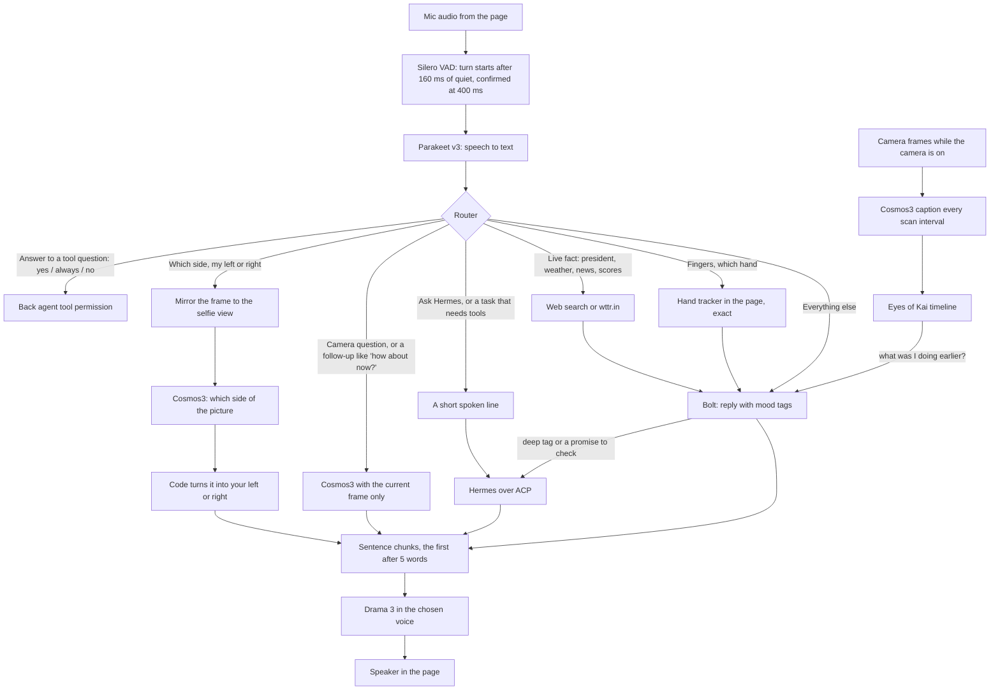

# keys-ghost-machine (audio/visual agent)

**Boo** is a ghost-faced audio/visual agent you talk to in a browser. It hears you (Parakeet v3), answers out loud in
about half a second (Nemotron 3.5 Bolt and Fish Audio Drama 3), looks through your camera (Cosmos3-Edge), counts your
fingers exactly (MediaPipe hand tracking), remembers what it saw (Eyes of Kai), looks up live facts, and hands real
work to a back agent with tools (Hermes over ACP), asking out loud before anything that runs a command or writes. The
models run locally on TensorFold, on a Mac with Apple silicon or on an NVIDIA DGX Spark.

Voices: [drowzeys/keys-ghost-machine-audio-visual-agent on Hugging Face](https://huggingface.co/drowzeys/keys-ghost-machine-audio-visual-agent)
(14 Drama 3 voices; Vesper is the default).

## Requirements

Two reference platforms, measured on the live stacks:

- **Linux on NVIDIA DGX Spark** (GB10, aarch64, CUDA 13, 128 GB unified memory).
- **macOS 26 on Apple silicon** (Metal).

| Component | Mac (memory) | DGX Spark (memory) | Disk |
|---|---|---|---|
| Nemotron 3.5 Bolt (TensorFold) | ≈ 45 GB | ≈ 31 GB | 24 GB |
| Drama 3 NVFP4 (TensorFold) | ≈ 28 GB wired (21 GB weights) | ≈ 21 GB | 21 GB |
| Cosmos3-Edge (TensorFold) | ≈ 2.8 GB | ≈ 3.5 GB | 2.4 GB converted (+7.2 GB original, needed only to convert) |
| Agent + Parakeet v3 | ≈ 3.1 GB (MLX) | ≈ 5.4 GB (NeMo) | ≈ 2.5 GB |
| Eyes of Kai | < 0.1 GB | < 0.1 GB | small |
| **Total** | **≈ 79 GB** | **≈ 61 GB** (+≈ 46 GB if weights are staged on /dev/shm for fast starts, optional) | **≈ 50 GB free** (≈ 57 GB while converting Cosmos) |

- **Mac minimum:** 96 GB unified memory (an M-series Max or Ultra); 128 GB or more recommended. Tested on an M5 Ultra
  with 256 GB.
- **DGX Spark minimum:** one DGX Spark (128 GB) with about 64 GB free. Everything fits on one node; the reference
  setup splits it over two.
- **Software:** TensorFold 1.1.4 (release binaries for Bolt; the Drama 3 and Cosmos3 builds are described under
  Limitations), Python 3.11 or later, Node 22 or later for Eyes of Kai, and a browser with a microphone and camera.
  Safari on an iPhone works over HTTPS (for example through Tailscale Serve).
- **Optional:** the Hermes back agent and a deep model; any ACP agent or OpenAI-compatible model can take their place.

## What happens in a turn

Every spoken turn goes through one router. Quick paths answer in the same turn; only real tasks go to the back agent.



Rules that make it behave:

- **Camera answers are about the current frame only.** The camera model gets a short instruction and this question,
  with no conversation history and no older caption, so it cannot repeat an earlier answer. A short follow-up to a
  camera turn ("how about now?", "are you sure?", "look again") looks at the live frame again, carrying the original
  question.
- **The person in the picture is "you".** The camera model is told the picture shows the user, never itself.
- **Selfie left and right.** Cosmos3 was trained on first-person robot cameras: it knows which side of a picture a thing
  is on, but not your sides on a face-forward camera. So the agent mirrors the frame to your own view, asks only for
  the picture side, and says it as your side in code.
- **Fingers and hands come from the hand tracker**, never the camera model, which miscounts them.
- **The back agent gets only your words** (plus camera or hand facts when used), never the front brain's lines. A reply
  that only promises to check is sent back once to answer.
- **Back-agent tools need a spoken yes.** Read and search tools run freely; anything that runs a command, writes or
  sends asks first, out loud and on the page.
- **Mood tags** such as `[happy]` drive the ghost's face and are never spoken.

## Measured speed

Voice-to-voice is the end of your speech to the first sound of the reply, measured by a client streaming 16 recorded
questions in real time, two passes each.

| Measure | Mac (M5 Ultra) | DGX Spark |
|---|---|---|
| Voice-to-voice, median | 0.51 / 0.57 s | 0.92 / 0.95 s |
| Speech recognition (Parakeet v3) | 72 ms | 86 ms |
| Drama 3 first audio, named voice | 108 ms | ≈ 500 ms (see Limitations) |
| Cosmos3 camera answer, first token / full | 78 ms / 0.25 s | 100 ms / 0.32 s |
| Camera question, voice starts | 0.37–0.46 s | 0.60–0.73 s |
| Left / right question, voice starts | 0.26–0.31 s | 0.55–0.74 s |
| Live fact (search or weather), voice starts | 1.3–3.8 s | ≈ 2.6 s |
| Back-agent task with tools | 30–50 s | 30–50 s |

## Settings in the page

- **Name**: what the assistant is called (Boo by default); it answers to it, and the header follows.
- **Agent**: the back agent (Hermes over ACP, or a direct OpenAI-compatible model).
- **Voice**: any voice the Drama 3 server loaded, with its description; **Futuristic** adds a light chorus, a short
  airy echo and a treble lift in the browser (no server cost).
- **Camera scan**: how often the camera is captioned into memory while the camera is on: every 1, 2, 3 (default), 5,
  10 or 30 seconds, or every 1, 5 or 15 minutes.
- **Memory**: how long captions are kept: 1, 2 (default), 3 or 5 days, or 1 week.

## Setup

1. **Engines (TensorFold).** Serve, each on its own port:
   - Nemotron 3.5 Bolt with the TensorFold 1.1.4 release (`tensorfold serve … --no-thinking --context 32768`), on
     `:8091`.
   - Drama 3 NVFP4 with named voices: `--voices ~/voices/<mac|spark> --default-voice vesper` (voices from the Hugging
     Face repo), on `:8098` (Mac) or `:8093` (Spark).
   - Cosmos3-Edge with `--vision` and `--keep-warm 0`, on `:8099`.
2. **Eyes of Kai.** Clone [tonyd2wild/eyes-of-kai](https://github.com/tonyd2wild/eyes-of-kai), apply
   `patches/eyes-of-kai-retention.patch` (`git apply`), set `PORT=3870` and `BIND_HOST=127.0.0.1` in its `.env`, and
   start it with Node 22 (`node src/server.js`).
3. **The agent.**
   ```sh
   python3 -m venv venv
   venv/bin/pip install -r requirements-mac.txt      # or requirements-spark.txt on a DGX Spark
   cp profiles/mac.example.json profiles/mac.json   # edit ports, voices folder and back agents
   ./serve.sh profiles/mac.json
   ```
   Open `http://127.0.0.1:8095/`. For a phone, serve it over HTTPS (browsers only give the microphone and camera to
   secure pages), for example with `tailscale serve --https=8443 http://127.0.0.1:8095`.
4. **Back agent (optional).** The example profile starts `hermes acp` locally. To use one on another machine, set its
   `command` to `["ssh", "-T", "user@host", "hermes", "acp"]`. The `deep` agent is any OpenAI-compatible endpoint.

`python -m voice_agent.bench ws://127.0.0.1:8095/ws a.wav b.wav …` measures voice-to-voice with your own recordings
(16 kHz mono WAV).

## Profiles

A profile names each engine and the turn timing:

- `asr`: `parakeet-mlx` (Mac) or `nemo` (Spark) with the model id.
- `brain`: the front model's URL, model name, system prompt and sampling.
- `voice`: the Drama 3 URL, default voice, voices folder (for previews and descriptions) and `first_words` (the first
  spoken chunk is cut after this many words).
- `turn`: VAD timing (`eager_silence_ms` starts work early, `end_silence_ms` confirms the end of a turn).
- `eyes`: the camera model; `memory`: Eyes of Kai's URL, the captioner and `interval_s`.
- `agents` and `agent`: the back agents and the default one.

## Limitations

- **Cosmos3-Edge on TensorFold** needs the Cosmos3 ports (a new Metal model family and its CUDA counterpart), which are
  not in TensorFold's upstream releases yet. Without them, point `eyes` and `memory.captioner` at any OpenAI-compatible
  vision model that accepts PNG images.
- **Drama 3 on the Mac** in the measured setup uses Metal changes offered upstream in
  [plotarmordev/TensorFold #1](https://github.com/plotarmordev/TensorFold/pull/1) (prompt rows) and
  [#2](https://github.com/plotarmordev/TensorFold/pull/2) (NVFP4 pruned experts), plus a voice prefix cache. The
  **DGX Spark** runs Drama 3 with [plotarmordev's TensorFold fork](https://github.com/plotarmordev/TensorFold); its
  first audio in a named voice is slower than the Mac's until the same prompt and voice-cache changes land there.
- Free-form camera descriptions ("describe what you see") can still name a side wrongly; questions about a side go
  through the reliable path above.
- Live facts come from web search snippets, which can be out of date; ask the back agent for anything that needs
  digging.
- Fish Audio's licence applies to Drama 3 speech: hosted services that generate speech for third parties need a
  separate licence from Fish Audio.

## Questions and issues

Please use [GitHub Issues](https://github.com/drowzeys/keys-ghost-machine-audio-visual-agent/issues).

## Licence and credits

The code is MIT (LICENSE). Every model, engine and library it uses, with its licence, is listed in
[CREDITS.md](CREDITS.md).
